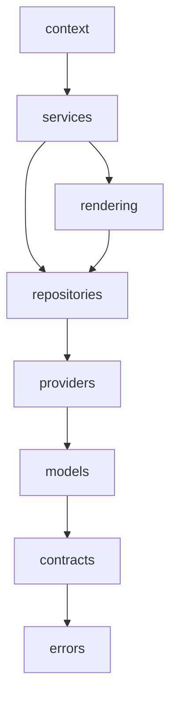
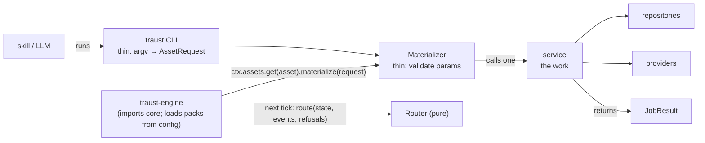
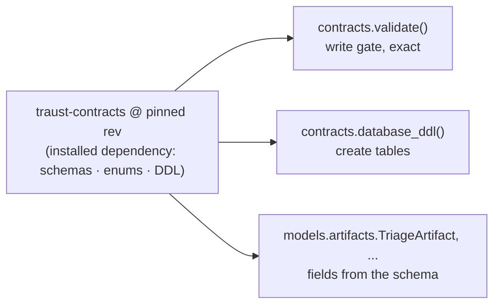

# traust-core

The shared Python base for traust: one clear place to read and write each kind of data, so scripts stop opening their own database connections, building their own paths, writing their own JSON and running their own subprocesses. Python callers (traust, traust-engine) use it in-process; other languages (the Go SDK, SCI) will reach the same services through the REST API served from here (resource/ID routes, request IDs, OpenAPI generated from the core models).

All modules live under `traust_core.v1` (see [Versioning](#versioning)).

| API | Module | Use it for | Instead of |
|---|---|---|---|
| **Contracts** | `contracts` | the pinned traust-contracts dependency, read as data: `validate(name, doc)` (exact JSON Schema gate), `schema_errors(name, doc)` (every violation as path and message), `risk_rating` (the contracts' OWASP Risk Rating arithmetic: `rate`, `problems`), `validate_config(name, doc)` (the `config/v1` gate: packs, policies), `schema()`, `schema_dir()` / `schema_path(name)` (the artifact schema files), `enum_values()`, `normalize_enum(name, value)` (registry read view), `database_ddl(dialect)` (every namespace, bootstrap order) | skills remembering to run `reporting validate` |
| **Errors** | `errors` | the exception hierarchy every layer raises (`ValidationError`, `NotFoundError`, …) | ad hoc exceptions |
| **Models** | `models` | one model per contract table, grouped by section — `inventory`, `dependencies`, `assessment`, `findings`, `operations`, `ledger` (fields = columns) — next to that section's service types; `base` (`Model` strict, `Dto` tolerant, `Entity` with a database-generated UUIDv4 id, `AppendOnly` for tables that are never updated), `values` (`HttpsRepoUrl`, `GitSha`, `CveId`, `to_rfc3339` / `TimestampError`: the contracts' one RFC 3339 rule), `integrity` | dicts passed between scripts |
| **Validation rules** | `models.validation` | `ValidationScope.permits(action, target, as_of=…)`, `ValidationPlan.requires_approval()`, `ValidationAttempt.soundness()` — pure scope, approval and refutation rules | duplicated harness scope and soundness rules |
| **Validation recording** | `services.validation`, `models.validation` | `record_order(doc, provenance, bindings, run_order_id, principal)` binds machine reports to a live order lease; trusted-local `record(doc, provenance, bindings)` and `evidence(artifact_id)` retain their existing semantics | re-running probes, interpreting source labels as database IDs |
| **Artifacts** | `models.artifacts` | the `ArtifactDocument` base + `SchemaView` (fields from the installed schema, `doc.findings[0].verdict`, unknown names raise) and the named documents (`TriageArtifact`, `SecurityAuditArtifact`, …, `Verdict`, `Severity`) | `json.load` + `.get("key")` |
| **Artifact publishing** | `services.artifact_publishing` | `ctx.artifact_publisher(specs).publish(name, raw)` or `.publish_artifact(artifact)`: exact gate → content-addressed objects → an artifact UUID on SQLite and Postgres; `get(artifact_id)` verifies the persisted digest; `list_for_assessment(id, kind=…)` reads metadata | writing `analysis-results` files by hand or optional indexing |
| **Secret detection** | `models.redaction` | `SecretDetector.evidence_rules()` yields ordered `SecretRule`s whose `spans(text)` return exact original `SecretSpan(tag, start, end)` offsets. Evidence extensions are additive: publication matches and extension matches use their own capture groups, then overlapping ranges merge into ordered, non-overlapping spans; adjacent ranges stay separate. Prefix/suffix word characters cannot suppress publication matches. Renderers choose markers, not regexes. Publication still uses `ctx.services().redaction` with its established prefix/PEM semantics; validation consumers can emit no-prefix length/digest markers and scrub structured Secret maps separately. | a consumer-owned credential regex table |
| **Code facts** | `services.code_facts`, `models.code_facts`, `providers.crypto`, `providers.crypto_image`, `providers.crypto_cluster`, `providers.route_guards`, `providers.route_ownership`, `providers.express_routes`, `providers.java_routes`, `providers.python_ownership`, `providers.syntax`, `providers.grpc_guards`, `providers.llm_app`, `providers.config_matrix`, `providers.sanitizers`, `providers.fork_lag`, `providers.priv_profile`, `providers.tree`, `models.elf_formats`, `models.crypto_formats` | `ctx.services().code_facts.collect/list/symbols/language_stats` over the latest `tool_scan` assessment's `CodeFactsArtifact`; measured LoC, exact symbol filters and snapshot-bound pagination. `code_facts.enumerate(kind, ToolRequest)` runs a deterministic `FactEnumerator` over a checkout (`CryptoProbe`: toolchains, images, policies a checkout configures; the secure-code pre-scans `RouteGuardMatrix` (Go, Django, Flask, FastAPI, aiohttp; Express, Spring and JAX-RS parsed with tree-sitter grammars loaded by `providers.syntax`), `GrpcGuardMatrix` (Go gRPC servers, their interceptors, the services registered on them and their methods), `LlmAppDetector` (whether a checkout is an LLM, agent or MCP application and which files use it, from imports, direct manifest declarations and prompt templates), `ConfigMatrix`, `SanitizerDiscovery` and `ForkDetector`, over `providers.tree`'s symlink-safe file walk); `code_facts.route_guards(ToolRequest, resolve_handlers=)` places handlers through the symbol index; route rows carry `ownership` on authenticated id routes (`providers.route_ownership`: scoped, checked, caller-blind, unchecked, none, unknown or n/a, with the spans behind it; caller-blind and unchecked rows are judged; filled for Spring and JAX-RS from each handler's path variables, caller, lookups by id, checks and one same-repository hop, and for FastAPI (`providers.python_ownership`) from the handler and the dependencies handed a path id); `code_facts.grpc_guards(ToolRequest)` is the gRPC service x interceptor matrix; `code_facts.coverage(ToolRequest, repository_ref_id=)` compares the repository's latest threat-model entry points (`assessment.threat_model_entry_points`) and what the pre-scans detected against the pre-scan for each entry-point kind, as covered, uncovered or unexplained; `code_facts.llm_app(ToolRequest)` is the LLM-application detection that gates the LLM review; `code_facts.priv_profile(ToolRequest, repo)` is the operator privilege profile (`PrivProfiler`: SCC requests, securityContexts, namespaces and install modes, every RBAC rule, and the shipped RBAC no `+kubebuilder:rbac` marker declares) as the contract `PrivProfileArtifact`; `code_facts.fork_lag(ToolRequest, offline=)` adds each tracked upstream version's advisories (`exposure.package_advisories`), a failed read being the result's `network` error; `code_facts.crypto(ref_id, ToolRequest)` adds the crypto packages of the ref's ingested manifest SBOM (`services.crypto_packages.CryptoPackagePolicy` over `exposure.dependencies`; `NoManifestSbomError` when none was ingested). `code_facts.image_crypto(digest, ImageRequest)` is the image tier (podman/docker inspect, create and `cp` through `ProcessRunner`, never running the image; DT_NEEDED from `models.elf_formats`) plus the crypto packages of the image's SBOM (`exposure.image_dependencies`; `NoImageSbomError`); `code_facts.cluster_crypto(ClusterRequest, ValidationScope)` is the cluster tier (`oc exec`, `openssl s_client` parsed by `models.crypto_formats`), every exec namespace gated by `ValidationScope.decide(k8s, exec)` and logged. Nothing is recorded: the facts are re-derivable from the commit | source scans at read time, a side symbol database, byte-based LoC estimates, `traust_engine.adapters.crypto_probe`, `crypto_audit` image/cluster tiers, `_util/elf.py` (linked libraries), traust secure-code-audit `enumerate_route_guards.py`, `traust_engine.adapters.llm_app`, `expand_config_matrix.py`, `probe_sanitizers.py` discovery, `run_fork_advisory_lag.py`, operator-priv-profile `build_priv_profile.py` |
| **Detection quality** | `services.detection_quality`, `services.rule_mining`, `models.detection_quality`, `models.rule_mining`, `models.validation_benchmark`, `providers.rule_drafts` | `ctx.services().detection_quality`: `record(BenchmarkTargetArtifact, provenance)` stores the recall-benchmark answer key (newest version scored; duplicate ids and held-out seeded targets refused); `run_benchmark({target_id: [assessment_id, rerun_id]})` scores each `benchmark_audit` report with the match ladder (fingerprint → advisory id + path → CWE + path ≥ 0.5 → near miss), injection canaries and rerun stability, `score_reports({target_id: [report, rerun]}, auditor_version)` scores unrecorded reports (canary runs on local repositories) the same way, derived on demand and storing nothing; `scorecards(BenchmarkFilter)` scores every recorded benchmark audit per auditor version; `BenchmarkRun.scorecard()` cuts recall by CWE/severity/provenance/language/split; `screen_injection(artifact_id)` flags obeyed-injection shapes in an audit report; `mine_rules(RulePack)` clusters confirmed findings by (primary CWE, language) against a pack, with per-rule precision from `occurrence.rule` and the calibration worklist; `regression_pairs(RegressionPairFilter)` gives each confirmed finding a decision recorded fixed on a later commit its files on the commit last reported and on the fix commit (read at the forge; nothing stored), the fixtures of a regression-rule draft; `sweep_cards(CardDeck.parse(doc).cards, ToolRequest)` runs each semantic precedent card's code-facts enumerator over a checkout and returns the rows its predicate matches as triage candidates (cards that are prose, not recipes, are rejected by `CardDeck.parse` with every reason); the class-generalization sweep: `sweep_collect(force)` classifies every confirmed finding rule-expressible or not (with why) into (CWE, language) classes, `sweep_drafts()` stages a candidate rule per class no pack rule or held draft covers, `sweep_rule(RuleSweepRequest)` runs one authored rule over the repositories with a completed secure-code audit on their default line (resumable per repository), `emit_sweep(rule, force)` turns the hits into triage candidates (never findings) with a summary, each stage's state kept in the object store; `propose_rule(RuleProposal)` is the gate for a rule inference proposes for an uncovered shape (`services.rule_proposals`: one well-formed rule, no catch-all pattern or path glob, no backreference, lookbehind or nested quantifier, its `ruleid:`/`ok:` examples firing exactly, and a capped hit count on the checkout); an admitted proposal is staged as a draft for the same calibrate-and-sweep path; `stage_regression_drafts(filter, skip_existing)` stages `regression_pairs` as drafts; `rule_lane(RuleLaneRequest)` runs the weekly rule-mining lane (mine → collect/draft → regression drafts → delta against the previous run, Stage-A gate reachability per watched pack, allowlisted-rule precision) with `RuleLane.exit_code` 0 quiet, 1 attention, 2 failed; drafts are written to the adopter's `locations.rule_drafts` by `providers.rule_drafts.RuleDraftDirectory` (`ctx.register_rule_drafts(root)`); the validation-lane benchmark: `benchmark_worklist(ValidationBenchmark)` (claims, validity unanswered), `score_benchmark(bench, run, variant, report)` onto `benchmark_scorecard()`, `benchmark_trigger(ToolRequest, since)` | `recall-benchmark/{match_benchmark,screen_injection}.py`, `traust_engine.sweep.{mining,engine,rule_lane,benchmark,calibration}`, traust `ops/compile_precedent_cards.py`, mine-ledger `emit_rule_drafts.py` |
| **Detection-quality workflows and views** | `models.rule_calibration`, `models.critical_misses`, `models.cve_replay`, `providers.tools.rule_calibration`, `providers.critical_miss_campaign`, `services.rule_calibration`, `services.critical_miss_report`, `services.cve_replay`, `rendering.benchmark`, `rendering.compliance_precision`, `context.benchmark`, `context.critical_misses`, `context.compliance_precision` | Integrated pack scans; pre-intake critical-miss reports; advisory replay candidates; typed benchmark and field-precision Markdown. See detection-quality operator workflows below. | Legacy script walkers, raw HTTP or scanner subprocesses in consumers |
| **Tool runs and audits** | `services.assessment`, `models.cloud_config`, `services.cloud_config` | `assessment.run_tools(checkout, [CHECKOV])` over `ctx.tools` (every tool ready first); `CloudConfigFacts.of(CheckovScan)` turns Checkov output into cited facts, fact ids, gaps and a snapshot id; `assessment.check_audit(doc)` then `record_audit(doc, ref, provenance)`: the report gate, a `cloud-config` assessment (degraded with gaps), every finding it states and its judgment on each as a decision (`FindingDecisions.record_assessed`) | `run_checkov.py`'s normalizer, gap register and `--validate-report` |
| **Analysis results** | `repositories.objects.analysis_results` | `ctx.analysis_results().read(TriageArtifact, subject)` / `.read_all(TriageArtifact, tree)`; raw `put/get/find(subject, kind)`; today's naming convention in one place | `json.load` + `"-security-audit.json"` path building |
| **Table repositories** | `repositories.traust.*`, `repositories.traust_ops`, `repositories.traust_ledger`, `repositories.contract` | one repository per contract table (`uow.findings.find_by_fingerprint(...)`, `uow.run_orders.claim(...)`); `SqlTraustUnitOfWork(engine)` opens all 33 on one connection — one transaction across sections | `sqlite3.connect`, inline SQL, per-script tables |
| **Product definitions** | `models.product_definitions`, `providers.product_definitions`, `services.portfolio` | `ctx.product_lookup.resolve_products(ctx.product_definitions(cache_dir).read(), mappings, packages=, repo_urls=, product_ids=)` (never opens the record store; `ctx.services().portfolio.resolve_products` is the same answer; `mappings` is the recorded product map, `portfolio.product_mappings()`, recorded with `portfolio.record_product_map(doc, provenance)`): ownership context from the cached product-definitions registry, a candidate generator never an owner: match tier (mapped > repo-url > advisory slug > none), the contact ladder (only `private_tracker_cc` is embargo-cleared; non-kerberos values dropped and recorded), the lifecycle window on the clock's day; a missing or malformed cache is `unavailable`, never no-match. Serialise with `model_dump(mode="json", exclude_unset=True)` | `traust_engine.registry.products`, `registry/feeds.py` (reads) |
| **Declared inventory handoff** | `models.inventory_reference`, `providers.inventory_reference`, `services.portfolio` | `ctx.inventory_reference` (`InventoryReferenceFile`), `portfolio.declare_inventory`, `inventory_declarations`, `inventory_export` join durable external service/person/source/manager/BU/tracker facts with core ownership, shipped versions and trusted product contacts; `accountable_contacts` also feeds the SLA digest | new contact/routing domain columns or fabricated Jira routes |
| **Repository observation** | `providers.forge`, `services.observation`, `services.portfolio` | `ctx.repository_observation()` records forge facts as repo-state assessments; `PortfolioService.default_ref()` resolves the current head from the latest completed default-branch observation, including when a branch returns to an earlier SHA; without one, work needing the current head requires observation first. `RepoStateQuery.repo_state()` derives exposure from component membership, repository visibility and upstream, plus risk tier and freshness from current domain data | forge scraping or adopter designation config inside Core |
| **Release discovery** | `models.release_inventory`, `providers.release_inventory`, `services.releases` | `Context.register_release_inventory` registers the inventory/dist-git feed; `services().releases.discover` snapshots it through `ExposureService`, records explicitly product-bound versions through `PortfolioService` and plans artifact passthrough plus major/minor threat reviews through `OpsService`; `passthrough` plans container/RPM audit orders and `targets` returns the exact pinned batch | release JSONL files and untyped seen-state manifests |
| **Portfolio analytics** | `services.portfolio_analytics`, `models.portfolio_analytics` | `services().portfolio_analytics`: unsigned weighted crown-jewel proposal, fleet IaC classification/baseline worklist with explicit unobserved hosts, and source-organization assessment/artifact navigation; registered insight views publish the same results | retired graph/SQLite ranking and filesystem-only index scripts |
| **Repository graph** | `services.insight_repository_graph`, `models.repository_graph`, `rendering.repository_graph`, `models.input_segments`, `providers.input_segments` | `insight.publish(ViewName.REPOSITORY_GRAPH, filter)` derives complete nodes/edges/statistics, Markdown, offline interactive HTML, GraphViz and Gephi from native relations; `Context.repository_inventory()` reads the shared typed source inventory snapshot | persisted graph rows and a second topology authority |
| **Records (pattern)** | `repositories.sql`, `repositories.tables` | `TableSpec` (columns once) + `TableFactory` (Postgres schemas or SQLite `ops_`/`ledger_` prefixes, by engine) + `SqlTableRepository` (`add`/`get`/`update`) on SQLAlchemy Core; sqlite or Postgres by URL. `record_columns()` (mutable: UUIDv4 id + `created_at` + `updated_at`) / `append_only_columns()` (UUIDv4 id + `created_at`, no `updated_at`) + `_insert_record`/`_update_record`, database-generated via `RETURNING`; `updated_at` kept by the contracts touch trigger, SQLite `uuid()` registered by `create_database_engine` | `sqlite3.connect`, inline SQL, client-minted ids/timestamps |
| **Object store** | `repositories.objects.store` | `ObjectStore.put/get/list` raw bytes by key, digest-verified (local dir, or `repositories.objects.s3.S3ObjectStore` with its typed `S3Client` port and the `[s3]` extra, selected with `artifacts.s3` in `traust.yaml` or injected as `Context(config, object_store=...)`). Startup and ambiguous-404 rechecks use a one-key listing within the configured prefix; bucket loss raises `RepositoryError` (`ConfigError` at startup), never a cache miss. The IAM policy needs `s3:ListBucket` for that prefix besides Get/Put; a missing-key 403 is checked by scoped listing, while denied existing keys remain failures. Custom HTTP endpoints are allowed only for loopback (`localhost`, `127/8`, `::1`); remote endpoints require HTTPS | `write_text`, `json.dump` |
| **REST API** | `rest` (`traust-core[rest]`) | `traust-server` / `create_app(context)`: routes only, one package per domain (`rest.ledger`, …, listed in `rest.domains`), shared plumbing in `rest.common`; bearer token → `Principal` (`Caller`), one unit of work per request (`CoreServices`), typed errors → problem+json, `X-Request-ID` / `traceparent` on every response and access-log line; OpenAPI from `make api-check`. Nothing else in core imports it | a REST service per repo, each with its own auth, errors and config |
| **Explicit recording starts** | `rest.ops`, `services.operations` | `POST /v1/orders/start`: `StartRecordingRequest` (`order`, `lease_seconds`) → `OpsService.start_recording` → existing `OpsService.start` → native leased `RunOrder`; verified machine identity and server-owned principal/asset/repository capabilities, no request-supplied worker | a second queue, machine approval, caller-promised recording permissions |
| **Authored secure-code records** | `rest.assessments`, `services.assessment` | `POST /v1/assessment-records`: `AssessmentRecordRequest` → `AssessmentService.record_secure_code` → exact canonical report, native assessment/artifact IDs and unjudged `IntakeResult` from existing finding intake | scanner relabeling, report-authored validity decisions, changing plain `record` |
| **Assessment intake bindings** | `rest.assessments`, `services.assessment`, `services.findings.decisions` | Authenticated `GET /v1/assessments/{assessment_id}/intake` → mapping-only `AssessmentIntakeBindings`; digest-verified secure-code report labels or triage row labels resolve only through their owner and assessment/baseline occurrence scope | receipt-trusted UUIDs, manufactured creation history, source-title matching |
| **Artifact reads** | `rest.artifacts`, `services.artifact_publishing` | Authenticated `GET /v1/artifacts/{artifact_id}` → native `Artifact` metadata; `GET /v1/artifacts/{artifact_id}/content` → digest-verified original bytes through `ArtifactPublisher.metadata` / `payload` | consumer report reserialization, obsolete SDK schema revalidation, direct object/database access |
| **Verification records** | `rest.remediation` | `POST /v1/verification-records`: exact UTF-8 report text, native `Provenance`, and `run_order_id` → `VerificationService.record_order` → native `Verification`; a verified machine must own a live lease for the report repository and a server-allowed verification asset | event envelopes, caller-supplied actor/signer, human countersigns |
| **Remediation fleet and fork views** | `services.remediation`, `models.remediation` | `remediation.fleet_targets_from_rollup(markdown, pattern)` resolves explicit numbered PROGRESS table targets through inventory, reusing typed `FleetScope` enrichment; `list_forks(RepositoryFilter, PageRequest)` returns paged `ForkMapping` rows under the existing private-fork policy, with unresolved reasons | path-owned campaign state, guessed repository URLs, unenumerable fork mappings |
| **Verification worklists** | `services.remediation`, `models.remediation`, `services.findings` | `verification.sweep(repository_ids, include_branches=False)` keeps repository/ref identity, branch head source and line-specific counts; `sweep_markdown(sweep)` renders the same queue through the shared Markdown renderer; `findings.on_ref(repository_ref_id)` folds resolution on the selected line | default-head verification suppressing a distinct release commit, report-file existence as verification evidence |
| **Validation report REST** | `rest.validation` | `POST /v1/validation-records` → `services.validation.record_order`; live leased `run_order_id`, exact report text, `Provenance`, native `ValidationRecordInput` bindings → `ValidationRecordResult` | source-label lookups, route-owned authorization or verdict rules, human decision commands |
| **Reporting** | `services.reporting`, `providers.report_files` | `ctx.reporting` (the same instance as `ctx.services().reporting`; it never opens the record store, so file-only callers use it) over a report document the caller holds, nothing stored: `validate(payload, XArtifact)` → contract `Issue`s; `validate_reports(path, strict=, schema=)` → a `ReportValidation` (errors, warnings) per report file at `path` (a directory sweeps its .json files; the schema comes from each file name unless a contract schema is named): the contract schema, then the family's content checks (`services.reporting.checks`: counts against findings, canonical ids, `metadata.repository`, dispositions, review surfaces, OWASP threat ratings) and, with `strict`, the audit-report warnings; `lint(doc, files=None)` runs every core `Lint` registered for the type; `render(doc, RenderFormat.MARKDOWN \| HTML)` (triage in both; security reports and threat models as Markdown: `services.reporting.report_markdown`, `services.reporting.threat_model`); `lint_threat_models(paths, strict=)` lints THREAT_MODEL.md prose (`threat_model.lint_threat_model`, OWASP cells via `services.reporting.threat_rating`; ATT&CK and ATLAS ids against the registered catalogs, which the pack always pins; without them the door raises naming the register doors); `lost_sections(existing, rendered)` (the render guard); `sarif_reports(root)` is the SARIF sweep's report selection; `sarif(doc)` for report and cloud-config audits (`SarifExport.report`, `locations.sarif_tool_uri` as `informationUri`). `ctx.services().redaction.redact(payload)` scrubs secrets (`RedactionPolicy`; `scan(text)` finds them without redacting) | `traust_engine.reporting` (`validate`, `lint`, `render`, `sarif`), `_util/redact.py` |
| **Findings SARIF** | `services.reporting` | `ctx.services().reporting.sarif_findings(baseline, repository_url)` projects caller-held `FindingView`s through the existing canonical SARIF renderer, preserving locations, fingerprints, suppressions, absent resolved findings and unrated severities. Like the existing document-only reporting doors, it is in-process and performs no storage or network I/O. | constructing `SarifExport` from a consumer |
| **Historical report signatures** | `services.reporting`, `services.ledger`, `models.ledger` | `validate_reports(..., signing_pubkey=Path(...))` optionally requires historical layer documents' stored-event Merkle tree and public-key signature through `LedgerService.verify_document`; `ReportValidation.integrity` exposes typed `DocumentVerification` / `IntegrityProblem` failures. Exact schema validation remains mandatory; the document-only API opens no database and writes nothing | unsigned defaults becoming signature requirements; signing or reviving layer writers |
| **Compliance reports** | `rendering.compliance`, `services.compliance` | `assessment_report(document)` → per-run `Report`; `ComplianceService.render_assessment(document)` / `export_markdown(artifact_id)` → Markdown bytes with coverage, every control and evidence citations | dropped per-run control-detail reports |
| **Fuzz evidence and campaigns** | `services.assessment`, `models.artifacts`, `models.insight`, `services.insight` | `assessment.fuzz_reports(repository_ids, as_of, latest_per_target=False)` retains run history; the default remains latest per target. `record_fuzz_campaign(FuzzCampaignArtifact, provenance)` / `fuzz_campaign(as_of)` retain supplied historical analysis through the artifact publisher without creating runs or findings. `ValidationFuzzView` renders declared per-crasher analysis/references, vectors/reproducers, explicit batches and target-pattern observations separately from the supplied campaign snapshot | estate-specific embedded bug tables, inferred pattern denominators or analyst claims |
| **Rendering** | `rendering` | `Report` → `MarkdownRenderer` / `HtmlRenderer` → `publish()`; structured headings/cells use `markdown_text()` escaping while authored `Section.body` preserves Markdown; `Report.patterns` enables the script-free `rendering.patterns` explorer | 18 copies of `render_md` |
| **Weakness references** | `providers.cwe_reference`, `services.findings.taxonomy`, `services.findings.classification` | Read-only `CweReferenceProvider.get()` and `TaxonomyPolicy.reference()` / `labels()` expose reviewed names, ASVS 5.0 and fix guidance; `CodeFindingPolicy.includes(locations)` uses explicit source paths/languages | harness CWE tables, CWE-name-based code/config guesses |
| **Reported insight history** | `services.insight`, `models.insight` | `InsightService.capture`, `snapshot`, `snapshot_bytes`, `history`, `report_history`, `compare`, `report_comparison`: immutable as-reported bundles through existing typed references/artifact rows and ObjectStore; methodology/version/scope and previous digest retained | treating today's `as_of` replay as the original published report |
| **Historical LoC** | `services.insight.LocView`, `models.insight.LocDashboard` | `insight.build/publish(ViewName.LOC, ViewFilter(as_of=…, compare_as_of=…, first_party_divisor=…))`: observed default head and recorded measurement selected no later than `as_of`; optional labelled estimate only with an explicit finite positive divisor; deltas only for repositories measured at both times | treating missing scans as zero, inferring calibration or equating historical recomputation with immutable reported history |
| **Jobs** | `models.operations`, `services.operations` | `Materializer.materialize(AssetRequest) -> JobResult` (succeeded · degraded · refused · failed): the seam traust-engine calls; `Router` for continuous-ops `route()` | each CLI inventing its own exit codes |
| **Freshness** | `models.language_coverage`, `services.operations`, `services.provider_catalog`, `services.insight_freshness`, `providers.product_definitions`, `providers.tools.releases`, `providers.language_coverage` | `ctx.services().freshness.stale()` composes feed and reference-registry age, tool readiness, upstream release age/lag, database age and a bounded stored-PQC-schema sweep; the freshness view adds current-default-ref dominant-language dependency/reachability coverage, dated review and assessment cadence, independently of reported audit gaps | calling availability “freshness”, dropping stored-schema or unsupported-language warnings when no audit reports a gap |
| **Providers** | `providers` | the outside world: `base` (`Provider`, `Readiness`, `Provenance`, registry), `tools`, `sources`, `feeds` (`FeedProvider`, `HttpFileFeed` for single-file feeds, `validate_payload`), `http` (`HttpFetcher` + `RetryPolicy`, the outbound HTTP path), `correlation` (`correlation_scope`: scoped request/order/run IDs passed to HTTP and subprocesses), `depsdev` (`DepsDevResolver`: deps.dev graphs and default versions through the feeds registry's `deps_dev` source, answers cached a day in the object store; `ctx.deps_dev`), `process` (`ProcessRunner`, the only subprocess path), `report_files` (`ReportFiles`: the report files a caller names on disk), `clock`, `model_catalog` (`ctx.model_catalog`: list prices and cost, plus roles: `list_roles()`, `resolve_role(role, tier)` (never below the floor), `validate()`, `stamp(role, model)` for a report's `model_routing`), `transcripts` (`ctx.session_transcripts.source(workspace, skills)`: Claude Code transcripts as a `SpendSource` for `SpendService.collect` and `usage_summary`, each request's skill inferred from the session's signals) | ad hoc `subprocess`/`git`/fetch code, 22 private `run` wrappers |
| **Tools** | `providers.tools`, `providers.tools.toolchain`, `providers.tools.safe_exec`, `providers.tools.elf`, `providers.tools.adapter`, `providers.tools.fleet_fix`, `providers.tools.compliance_sources`, `providers.tools.detection_quality`, `providers.tools.opengrep`, `providers.tools.osv_manifests`, `context.tools` | `ctx.register_toolchain(external_tools, safe_exec_profiles)` reads both files on first use; `ctx.toolchain` (`Toolchain`: `external-tools.yaml`'s `ToolPin`s, `version`, `database`, `populate`, `check` / `preflight` and `preflight_failures`, `freeze_env` / `freeze_flags`) probes only the pinned binaries; `ctx.safe_exec` (`SafeExec`: the deployment's profiles, `validate_argv`, `vet_command_string`, `run`, `run_segments` through `ProcessRunner`, pipelines with no shell); `ElfAnalyzer` (header, linked libraries through `models.elf_formats`, byte patterns); `AdapterTool` wraps a scanner adapter's `scan()` as a `ToolProvider`, and core's scanners are registered by name from `context.tools.scanner_tools`, each one's floor the pin of its binary. `ctx.register_fleet_fix()` (`GitFleetFixApplier`: https-only clone, `git ls-remote`, ast-grep, diffs; also the golden runner), `ctx.register_compliance_sources()` (`GithubAdrSource`, `RedHatDocSource`) and `ctx.register_detection_quality(pack_version, canary_sources, canary_repos)` (`OpengrepRulePacks` over the pack `ctx.register_rule_pack(pack, allowlist)` registered and the `rule-pack-allowlist` supplements cloned under `providers.tools.opengrep`'s cache, read on first use; `GitCanaryMaterializer`; `OpengrepRuleSweep`, one rule over many checkouts, shallow https clones through `GitCheckout.clone`) set the non-scanner providers; rule packs and allowlists stay pack config passed by path; `osv_manifests` holds the osv scan's lockfile and manifest readers (only `providers/tools/osv*` reads them: the portfolio SBOM is syft's) | `traust_engine.toolchain`, `_util/safe_exec.py`, `_util/elf.py`, `adapters/tools.py`, `adapters/{fleet_fix,compliance_sources,detection_quality}.py`, `portfolio/parsers.py` (for osv), `depsdev/` |
| **Tool reports** | `context.tool_reports` | the documents `traust adapters <tool>` and `traust util elf` write, one function per tool, each on the binary and timeout the caller passes: `opengrep_report`, `govulncheck_report`, `gitleaks_report`, `yara_report`, `k8s_hardening_report`, `joern_report`, `osv_report` / `osv_sbom_report` (OSV API through `ctx.advisories` and `ctx.deps_dev`, or offline osv-scanner), `elf_report`; `populatable_tools`, `toolchain_failures`, `tool_stamp` for `traust admin toolchain`. Interim: the tool execution API reshapes them | traust-engine `adapters/*` CLI entry points (`_execute_opengrep_scan`, `_run_govulncheck`, `_run_gitleaks`, `_execute_yara_scan`, `checkov.Scanner`, `_run_joern_scan`, `osv.scan_api` / `run_scanner`, `osv_sbom.*`), `_util/elf.py` |
| **Code scanners** | `providers.tools.opengrep`, `providers.tools.govulncheck`, `providers.tools.joern` | registered as the `opengrep`, `govulncheck` and `joern` tools; each `scan()` returns an `AdapterResultArtifact` built by `adapter.adapter_result`. `ctx.register_rule_pack(pack, allowlist=None)` names the opengrep rule pack and the `rule-pack-allowlist.yaml` enabling its supplemental packs per rule (`ctx.rule_pack`, `ctx.rule_pack_supplements`; security content stays pack config, passed by path); `opengrep.execute_scan` is the full facts report (rules with pins and licenses, supplements applied and skipped, the allowlist, coverage by language), `context.tools.load_rule_allowlist` parses `--rule-allow`; `govulncheck.run_govulncheck` runs under the `go-scan` safe-exec profile and `parse_stream` gives one candidate per OSV at its most specific reachability; `joern.run_scan` is the call-site facts document over a `SymbolQuery` (`with_soundness` states the evidence asymmetry) | `traust_engine.adapters.{opengrep,govulncheck,joern}` |
| **IaC, secrets, malware scanners** | `providers.tools.cloud_config`, `providers.tools.k8s_hardening`, `providers.tools.gitleaks`, `providers.tools.yara` | registered tools `checkov` (`CheckovProvider`: the pinned Checkov, offline, as `CloudConfigFacts`), `gitleaks` / `gitleaks-history` (`Gitleaks`: secret-free candidates over the rules `locations.gitleaks_config` names) and `yara` (`Yara`: known-malware-family facts over a pinned rule pack); `k8s_hardening.Scanner` (the KHS-* manifest checks and tenancy signals); `adapter_result` builds any adapter's `AdapterResultArtifact` | traust-engine `adapters/cloud_config.py`, `checkov.py`, `gitleaks.py`, `yara.py`, `_contract_bridge.py` |
| **Deps and SBOM scanners** | `providers.tools.osv`, `providers.tools.osv_sbom`, `providers.tools.grype` | registered by `scanner_tools`: `grype` over a checkout or SBOM path, database frozen by default; `osv`, a checkout's declared packages looked up through `ctx.advisories` with coverage reported, `osv.scan_api(..., resolver=ctx.deps_dev)` for the full candidates document; `osv_sbom`, an image's syft JSON language packages not installed by an OS package, with `mark_grype_duplicates` / `grype_os_installed_matches` and the air-gapped osv-scanner path; CVSS through `models.dependencies.cvss_base_score` | `adapters/{osv,osv_sbom,grype}.py`, `osv/` (client: reuses `providers.osv`) |
| **Config + Context** | `context`, `context.documents` (the YAML codec: `yaml_documents`, `yaml_documents_with_lines`, `yaml_text`, passed to providers, which don't import yaml), `context.preflight` | one `traust.yaml`; `Context` builds everything ([ledger and identity sections](docs/configuration.md)). The deployment config home: `resolve_config_home(explicit)` (`$TRAUST_CONFIG_HOME`, else `~/.traust/config` when it exists), `config_path(name)` (`DeploymentConfigMissing` naming the file and its template), `optional_config_path(name)`, `config_completeness_audit()` (`(errors, warnings)` for `install_traust --doctor`). `Context.preflight(requirements)` (`context.preflight`): one readiness door the engine's start gate, the platform doors and `traust doctor` call — a `Requirement` (`models.operations`, the pack schema's `requires:` vocabulary: tools, config keys, recorded facts, feed sources, secrets) is checked against `Toolchain.preflight`, the traust.yaml keys `Config.provided` records, the recorded facts, the enabled feed sources, the environment and the config home audit, raising `PreflightError` with every gap and its fix; `schema_dir()` / `schema_path(name)` / `validate_config(name, document)` and the ops types consumers annotate with (`OpsService`, `SpendService`, `FeedQuery`, `Router`, `Clock`) re-exported for consumers | `os.environ`, scattered config files, `traust_contracts.config` |

## Compliance assessment reports

`services.compliance.ComplianceService` owns deterministic evaluation and its run-twice gate.
`calibrate(request, key=None)` compares assessment, coverage, citation-gate outcomes and both
actual OSCAL exports, including document/result/observation UUIDs. Only assessment
`generated_at`, OSCAL metadata `last-modified` and result `start` are ignored.
`RunCalibration.oscal_compared` is false for selections outside the supported 800-53 spine;
it is never a claim that an unsupported OSCAL export was compared.

`render_assessment(document)` returns per-run Markdown bytes with target, per-framework
coverage, skipped-framework reasons, every control's verdict/reason and evidence citations.
`export_markdown(artifact_id)` reads a recorded assessment and produces the same report.
The pure `rendering.compliance.assessment_report(document)` builds the shared `Report` value;
it does not recompute verdicts or substitute aggregate posture for control details.

`history(scope_id)` returns recorded runs newest first, deduplicating one assessment attached
to multiple member repositories. `summary(ComplianceFilter(as_of=timestamp), dimension)`
uses the latest assessment at or before that instant against current boundary declarations.
It does not reconstruct past inventory or past declarations.

The `compliance` insight view supports product/team repository scopes, reports the standard
inventory population, and groups explicit cloud-config audit `control_refs` by recorded
ownership. Each reference counts distinct non-false-positive findings; missing references are
reported, not inferred. Framework/boundary coverage includes whole declared boundaries
intersecting selected repositories. Inventory/declarations remain current, while findings and
assessments replay to `as_of`. Historical framework posture renders only with at least two
distinct recorded assessment times within the requested window; no synthetic snapshots or
interpolated buckets are generated.
Cloud-config audit is currently the only contract-defined control-reference-bearing artifact
admitted by Core finding intake; security-audit/report and triage do not define `control_refs`.

`Config.compliance.docs_targets` maps registered product UUIDs to
`context.DocsTarget(product_slug, version, guides=())`. `Context.register_compliance_sources()`
validates those product references and registers the real docs.redhat.com provider; passing an
explicit target mapping selects sources for one invocation without rewriting configuration.
An empty guide selection discovers links from the actual official product page.
Missing metadata names the exact `compliance.docs_targets[<UUID>]` entry and required fields;
it never substitutes product names, guessed versions or generated documentation.
See [configuration](docs/configuration.md) for the full adopter configuration path.

## Portfolio views and source hierarchy

`repository-graph`, `crown-jewel-draft`, `iac-census` and `organization-index`
are registered native insight views. They share the product/team/time scope and
publish typed JSON plus human reports; repository graph publication additionally
returns `RenderedView.graphviz` and `.gexf`.

`Context.register_input_segments(root)` optionally overrides the configured
inventory source. `Context.repository_inventory()` returns the same typed
`InputSegmentInventory`: declared-order segment repository URLs plus cited
hierarchy relations. Unregistered inventory URLs remain visible; no graph table
is created. A malformed or missing configured source raises a contextual error.
Context injects its YAML codec into the input provider. Direct construction is
`InputSegments(root, yaml_documents)`, with the codec from `context.documents`.
`ViewFilter.exclude_segments` controls graph exclusions. Inventory hierarchy
describes the current file snapshot; recorded relationships, ownership,
assessment coverage and finding state honor the stated point in time.

The interactive graph contracts version/category/ref/artifact nodes only for the
overview. Full JSON keeps every relationship and branch identity. Hub degrees
exclude the additive ref layer. Its HTML is self-contained with CSP-authorized
renderer code, keyboard/list navigation, pan/zoom, search, segment focus and safe
source links; no remote scripts or network fetches.

The crown-jewel view is an unsigned proposal for human review. It joins available
declared fan-in, standing threat impact, privilege and open finding signals,
renormalizes their weights, and states gaps. It does not mutate approved
`RepoState.crown_jewel` facts or change routing.

## Release discovery

`ReleaseInventoryFeed` compares payload CSV image digests/tags and inventory-local image keys,
and HTTPS watched dist-git heads, with the previous `release-inventory` feed snapshot.
The first observation seeds a baseline without audit orders. Failures keep the watched
repository's previous head and report a skipped source; malformed snapshots refuse to reseed.

`ReleaseDiscoveryService` composes the existing portfolio, exposure and operations services.
`discover(principal, routing)` records explicitly product-bound inventory versions, then plans
artifact passthrough orders and source-repository threat reviews for major/minor inventory
bumps only. A dist-git commit never becomes a release version. `passthrough` plans the
container/RPM audit assets from the observations in its order's rule; `targets` returns those
same observations, including the exact RPM commit. Pending observations remain in the feed
until represented by artifact orders, including when an older order is already in flight.

`ReleaseRouting` is supplied by the consuming pack, which owns asset names and priority.
`PortfolioService.list_releases(product_id)` and `list_release_refs(release_id)` expose native
release/component membership without using the event feed as an inventory listing.

## Repository liveness

`PortfolioService.record_forge_facts` records the latest availability attempt in
`RepoLivenessArtifact`, an imported reference document owned by that observation
path and published through `ArtifactPublisher.publish_successor`. No new liveness
database or synthetic commit is needed, even when a repository has never had an
accessible head. Existing completed repo-state assessments remain the source of
the last successfully observed default ref.

`PortfolioService.liveness(filter, page)` returns `Liveness` rows with `status`,
`status_since`, `observed_at`, and a canonical destination for a rename. Repository
UUIDs and registered URLs do not change on redirects. Repeated statuses retain
their original `status_since`; a transition starts at the new attempt. Repository
lookup absence is distinct from authentication, rate limits and network failures,
which are unknown. Unqueried repositories have no availability timestamps.
Dormancy is calculated at read time from a reported push, not stored separately.

When `OpsService` is wired, the same liveness query also reads completed legacy
`repo_state` observation failures from their lossless manifest degradation fields.
Newer recognized failure evidence supersedes older availability; newer real
availability supersedes older failures. Repeated unknown outcomes retain the
original transition time. A successful order without availability evidence never
manufactures reachability, and direct availability recorded during an order
outranks its lossy completion summary. PQC and other consumers read this owner
instead of interpreting order outcomes independently.

`SpendService.record(event, usage=..., calibration=SpendCalibration(...))` preserves
the original request/cache usage and optional repo/loc/batch/note tuple in a typed
reference linked to the settled event; `evidence(event_id)` reads it. Collection and
order completion preserve request evidence automatically through `Context`.
`reprice(window)` compares only complete, currently priceable evidence without
rewriting booked dollars. `ViewFilter(reprice_spend=True)` adds that comparison to
the spend view, with covered settled dollars and explicit unavailable event IDs.
`ViewFilter(workstation_spend=True)` adds a separate original-transcript BU table:
`SessionTranscripts.attributed(workspace, skills, registry)` joins exact paths to
existing corpus trees, leaving unknown/conflicting paths unattributed. It never
redistributes unknowns or adds transcript estimates to settled totals.

Core-owned typed references use `ArtifactPublisher.publish_reference(name, Model)`,
`reference(artifact_id, name, model_type)` and `references(name, limit)`. They reuse
the artifact table and digest-verified object storage with the secret gate; they
do not bypass or change contracts validation for skill artifact documents.
## Freshness

`ProductDefinitionsCache.status()` returns `ProductRegistryStatus` retrieval metadata from the
existing cache. Its `registry:product-definitions` row becomes stale after 168 hours;
an optional registry never fetched is pending, while malformed metadata or a lost recorded
cache is unavailable. This backstop is independent of the ownership lookup's longer tolerance.

`ToolReleases(HttpFetcher, github_token=...)` resolves `ToolRelease` metadata through the
manifest's `ToolUpstream` / `UpstreamKind` references (GitHub, PyPI or the Go proxy).
`ProviderCatalog.release_freshness(now)` keeps release content age separate from readiness:
the authoritative Checkov pin is stale after 90 days; a tool behind a newer release becomes
stale once that release is older than 14 days. Missing tools are pending, lookup failures
and unknown versions unavailable. No lookup advances a pin or installs a binary.
`Context.register_toolchain()` wires this into aggregate freshness.

Optional native test tools use the same shipped manifest. `universal-ctags` is
adopter-provided, not a production install requirement. Its source URL and SHA256,
and the versioned Jansson build dependency, are recorded under the tool's `source`
and `build_dependencies` fields. An opting-in installer must verify those hashes
before building a JSON-capable binary; metadata lookup never installs either one.

`ArtifactPublisher.pqc_schema_compatibility(sample_size=50)` returns
`ArtifactSchemaCompatibility`: newest-first artifact IDs, checked count, whether more exist,
and `ArtifactSchemaFailure` entries with `ArtifactSchemaProblem` and typed issue paths.
It verifies persisted digests and parses through the current `PqcFactsArtifact` schema,
even without a direct PQC consumer read. Missing, corrupt or incompatible documents make
the freshness row stale; an empty corpus is pending. A clean bounded sample is not a
full-corpus compatibility guarantee. The sample bound is 1–1000.

The freshness view reads `CodeFactsService.language_stats()` on current default refs;
the dependency and symbol-tier thresholds are 10 and 50 dominant repositories, respectively.
`LanguageCoverageCatalog` derives dependency support from the SBOM provider and reachability
support from the same analyzers wired into exposure, with reasoned no-dependency exemptions.
`providers.syft.LANGUAGE_MANIFESTS` names native manifest surfaces;
`providers.syft.dependency_ecosystem(language)` intersects retained manifests with
`models.sbom_formats.PURL_ECOSYSTEMS`, the parser's accepted ingestion roster.
Discovering a manifest alone does not prove that its packages survive ingestion.
Unmeasured, unknown and failed measurements remain distinct from covered languages.
Reported latest-audit gaps remain a separate section.
`FreshnessDashboard.language_coverage` is a typed `LanguageCoverage` population with
`LanguageCoverageRow` entries; `ReachabilityReview` and `ReachabilityWatch` describe the dated
reference, not an assertion of engine coverage.
`Context.register_reachability_review(path)` supplies a `ReachabilityReviewFile` parsed through
the context YAML codec. Its `reviewed` date, `review_cadence_days` and `watch` reference are
deployment facts, never a shipped assertion that review happened. An absent/unreviewed
reference is pending, invalid unavailable and overdue stale.
## Repository checkouts

Use `ctx.checkouts` to acquire a pinned commit and release its workspace when finished.
Mirror checkouts and refreshes fetch a missing requested commit directly, including commits
retained only by PR/MR refs, without caching the whole review-ref namespace. GitHub and
GitHub Enterprise use HTTP Basic token authentication for Git; REST authentication is separate.

Eviction skips in-flight acquisitions and registered worktrees. Refresh does not reset the
last-checkout idle clock. Local-origin checkouts and history reads accept full SHA-1 and
SHA-256 commit IDs, under the deployment's existing process policy.

Eviction discovery stops at bare-mirror roots, so refs such as `release.git` are never treated
as cache entries.

## Remediation target and verification scope

`fleet_targets_from_rollup` accepts Markdown content, never a filesystem identity.
Only numbered table rows whose text matches the case-insensitive regex contribute
their explicit second-cell target (registered URL/link or unique owner/repository
path). Unknown or ambiguous targets fail closed. An empty match stays empty.
The result uses the existing owner/product enrichment and carries rollup provenance;
it changes neither findings nor apply authorization.

`list_forks` enumerates registered repositories, not a second mapping store.
Explicit private inventory mirrors and the configured fork-org/private-forge rules
are the same policy used by `resolve_fork` and `prepare`. Unresolvable repositories
remain visible with `unavailable_reason`, not a public push fallback.

Verification sweeps remain read-only routing. Default heads require completed
repo-state observations. Optional non-default branches prefer the latest completed
branch observation (including a returning SHA); without one they use the latest
registered ref, explicitly labeled `registered_branch`, not a live-head assertion.
The queue uses findings and resolution on that named line and only real recorded
verification results to suppress already-verified heads. Shared validity/severity
and forward-only remediation status remain unchanged. `VerificationService.record`
owns verdict/decision/regression recording; `list` reads its retained report results.
Markdown worklists are human-readable exports, never authoritative state.

`FindingService.on_ref` is also exposed by the harness's
`findings baseline --repo-url URL --ref-id UUID` reader. When the same original SHA
has reporting baselines on several named lines, a new verification must identify
the line through its registered `metadata.patched_ref`; an ambiguous baseline is
refused before publication. Replaying an already-recorded report preserves its
original baseline even if further branch audits have since been recorded.


## Operational logging

`traust-server` calls `Context.configure_logging()` before serving. Embedded callers call it
once at their own entry point; repeated calls do not add handlers. Core logs use the configured
outputs: stderr and a rotating file under `Config.home` by default. Select only stderr when a
platform collector owns shipping and retention. The default level is INFO, including the REST
access logger. For example, in the core config YAML:

```yaml
logging:
  outputs: [stderr, file]
  level: INFO
  levels:
    traust_core.rest.access: INFO
  format: json # or text
  file: logs/traust.log
  max_bytes: 10000000
  backups: 5
```

REST requests bind a validated `X-Request-ID` (or `traceparent` ID) for access, error and
provider events. Background entry points owned by traust or traust-engine must bind
`correlation_scope(request_id, order_id=..., run_id=...)` themselves; Core passes the scoped
request ID to outbound HTTP and to `ProcessRunner` as `TRAUST_REQUEST_ID`.

## Validation rules

`ValidationAction(kind, verb)` describes a scope operation; `ValidationTarget` supplies its
context, namespace, resource, name, image, artifact ID or URL. `ValidationActionKind` covers
Kubernetes, container, WASM, browser, credential and inventory operations; it is distinct
from the contracts-owned execution-adapter vocabulary on `ValidationPlan.adapter`.

`ValidationScope.permits(action, target, as_of=date)` evaluates expiry, off-limits rules,
control-plane locks and positive grants. The caller supplies the date from `Clock` and
resolves WASM artifacts to UUIDs before evaluating scope. Binding `modes` retain their
constituent modes; credential and inventory grants require `explicit`. Cluster
`explicit_namespaces` contain only explicit engagement grants, never inline or inferred ones.
Browser verbs come from the first target whose origin matches the concrete URL.

`ValidationPlan.requires_approval()` is true for `interactive`, false for `auto` and
`dry-run`. It answers the human-review requirement, not permission to execute.

`ValidationAttempt.soundness()` returns `SoundnessResult(verdict, flag)` without changing
the attempt. `ValidationProbe` projects only the needed observations: verdict, verb,
transcript, positive-control outcomes and differential discrimination. The caller supplies
deployment-failure observations and the required `controls_required` / `differential_required`
inputs (legacy report thresholds: 0.177.0 / 0.178.0). Producer-stamped flags are preserved;
unsound refutations become `inconclusive`. At finding level, one sound refuting probe can
sustain a refutation unless a deployment, control or differential gate invalidates it.

Trusted in-process callers may use
`ctx.services().validation.record(ValidationArtifact.parse(raw), provenance, bindings)`.
Remote runners use `record_order(doc, provenance, bindings, run_order_id, principal)`,
the same protected service entry point as REST. Supply real `Provenance`
(`run_id`, `source=SourceType.VALIDATION_REPORT`, `occurred_at`) from the producing order;
recording does not invent a run, timestamp or execution plan, or execute live probes.
The binding JSON shape is:

```json
{
  "sources": [{
    "source_report": "audit.json",
    "assessment_id": "<existing-source-assessment-uuid>",
    "artifact_id": "<existing-source-artifact-uuid>",
    "findings": [{"source_id": "F001", "finding_id": "<existing-finding-uuid>"}]
  }],
  "policy": "current",
  "target_attestation": {"attested": true},
  "install_failed": false
}
```

Parse that object with `ValidationRecordInput.model_validate(...)`. `sources` binds report
labels to real assessed artifacts; `findings` maps source-local labels to real findings
with occurrences in that source assessment. Labels are never reinterpreted as UUIDs or
walked as filesystem paths. Recording checks the source artifact's assessment, baseline,
repository and, where present, report/triage/threat-model labels and fingerprints.
`install_failure` optionally retains the supplied deployment-failure explanation.
`target_attestation.attested` must be a boolean; the full attestation's extra fields survive.

`ValidationRecordingPolicy.CURRENT` (`"current"`) is the strict default: target attestation,
positive controls, differential discrimination and confirmed evidence-grade gates all apply,
even for a reset producer version such as `0.34.3`. Only explicit `HISTORICAL` (`"historical"`)
uses the old numeric release-triplet cutoffs: attestation `0.176.0`, controls `0.177.0`,
differential `0.178.0`, confirmed-grade gate `0.179.0`. Valid prerelease/snapshot/build
suffixes do not lower those gates (`0.179.0-rc.1` still requires a grade). Malformed
semantic versions are rejected in either mode; E3 confirmations still require review.

`ValidationRecordResult` returns `assessment_ids`, `artifact_ids`, `evidence_artifact_ids`
and per-finding outcomes with their decision/review IDs. `ValidationRecordingEvidence`
retains `format_version=1`, `source_report`, the report digest, provenance, bindings and policy
outcomes in assessment-owned `artifact` rows of kind `validation-recording`; the raw report
keeps kind `validation`. Findings link to that evidence with `finding_external_ref` system
`traust.validation` and ref `traust:artifact:<evidence-id>#finding=<finding-id>`.
Read it with `ctx.services().validation.evidence(evidence_artifact_id)`, not by parsing a URI.
`FindingDecisions.record_validation` remains the decision owner; evidence-only outcomes do
not invent neutral decisions or new occurrences that could change severity or locations.

`ValidationRecords` owns the shared evidence reader used by validation and precedent lookup.
It verifies retained report and companion digests and reuses the recording soundness rules;
`check_refutations(decisions)` returns a typed per-decision exclusion reason, or `None` when
eligible. A sound recorded refutation can supply machine precedent context, while human
review, current-disposition and correction guards still apply. Candidate metadata is batched;
artifact reads occur after database reads close. Missing or unverifiable evidence is explicitly
excluded; operational storage failures propagate.

## Layers

Dependencies point inward only; `tests/v1/test_layering.py` fails the build on a violation.



## How work reaches a service



traust and traust-engine import core and call services in-process. The CLI exists only so an LLM can enter the Python world. Worked example: `tests/v1/example/continuous_ops/`.

## Two setups, one API

| | Local user | SCI / team |
|---|---|---|
| Config | `artifacts.path` only | + `database.url` (Postgres), object store |
| `ArtifactPublisher.publish` | validate → objects → SQLite `artifact` row | validate → objects → Postgres `artifact` row |

With no `database.url`, `Context` keeps the record store in SQLite at `<home>/traust.db` (`home` defaults to `~/.traust`) and creates the schema from the traust-contracts DDL on first use. A configured `database.url` is never touched: whoever provisions it creates the schema (`apply_schema(engine, contracts.database_ddl(dialect))`). `ctx.services()` builds every service over one shared unit of work. Contracts owns and tests the schema; core tests repository behaviour.

## Run the REST API locally

```bash
make serve-local                      # http://127.0.0.1:8080, Swagger at /docs; SQLite under .local/home
make token NAME=me@example.com        # a person's token  -> .local/me@example.com.token
make token NAME=runner-1 MACHINE=1    # a runner's token  -> .local/runner-1.token
```

The first run writes `.local/traust.yaml` (`home` plus `identity: { trust_local: true }`: this machine's local issuer is trusted, for development only); edit it to add `database.url` for Postgres. Tokens last seven days. From Go, `traust.NewClient(traust.Config{BaseURL: "http://127.0.0.1:8080", Tokens: traust.FileTokenSource{Path: ".local/runner-1.token"}})`; a person's token is what submitting orders and decisions need, a runner's what claiming and completing need.

Outside `make`, the same is `traust-server --config traust.yaml` and `traust-server --config traust.yaml token NAME [--machine]`. `token` refuses a config without `identity.trust_local`; a deployment trusts its OIDC issuers instead (`identity.issuers`).

## Usage

```yaml
# traust.yaml (local user)
artifacts: { path: ./analysis-results }
```

```python
ctx = Context.from_file(Path("traust.yaml"))  # entry point only
publisher = ctx.artifact_publisher(SPECS)  # SPECS: the caller's PublishSpecs
published = publisher.publish("triage", raw_bytes)
triage = publisher.get(published.artifact_id)
```

`POST /v1/verification-records` requires a verified machine bearer token and a strict
`{"payload": "<original JSON text>", "provenance": {...}, "run_order_id": "<order UUID>"}`
body. The report is parsed as `VerificationArtifact` without reserializing its evidence
bytes. `VerificationService.record_order` admits only the live lease holder of an order
for the report's repository and an asset in the server's `recording.verification`
allowlist (empty by default). `provenance.run_id` must equal `run_order_id`; the new
assessment durably records that order, and replay cannot move it to another order.
The lease remains locked through the report's mutations and is rechecked before commit.
Admission and replay return the owner's native `Verification`; 401, 403, 404, 409 and
422 use `application/problem+json`. Original finding references must be native UUIDs;
event envelopes and layer IDs are not request fields. Authentication is not a human
countersign: report verdicts remain machine-assessment judgments under the owner's policy.

`POST /v1/validation-records` requires a verified machine bearer and a strict JSON body
with `run_order_id` (UUID), `payload` (the original UTF-8 JSON text), `provenance`
(`Provenance`) and `bindings` (`ValidationRecordInput`). The service locks that order
through recording and requires its live lease to belong to the actual caller. Its asset
must appear in the server's `recording.validation` allowlist (empty by default), and
every source assessment must belong to the order's one non-null repository.
`provenance.run_id` must equal `run_order_id`; new assessments retain that order ID.
Native assessment, artifact and finding UUIDs are required; source report paths and
labels do not establish identity. The existing validation owner retains exact bytes,
applies policy/target/soundness/grade rules and returns `ValidationRecordResult`.
Exact retries under the same live lease retain native IDs. A distinct producing order
may record a distinct run of identical report bytes, including a reference to matching
retained report evidence. Each new run gets its own native assessment and artifacts;
existing rows and their order linkage are never adopted or relinked.
Recording neither extends the lease nor completes the order.
Reports remain unsigned machine judgments or review-only evidence, never human
sign-offs. Errors use problem+json: 401 (bearer), 403 (caller, holder, repository or
asset), 404 (unknown order or binding), 409 (lease state, expiry, replay or evidence
integrity), 422 (body, report, binding or run-ID validation).

## Worked examples (copy these shapes)

Recorded code-fact reads never invoke tools. Attach a
`CodeFactsArtifact` through `AssessmentService.record(..., kind=AssessmentKind.TOOL_SCAN, ...)`.
The latest assessment is authoritative: failed/degraded scans, missing evidence,
and unmeasured sections are explicit errors, not zero counts or older snapshots.
Symbols are ordered by path, line and name and match exact name/path filters.
Facts pages are limited to 1–1000 entries, with cursors bound to the artifact and
requested kinds; a changed latest scan invalidates the cursor. Crypto facts are not
recorded: `code_facts.crypto(ref_id, ToolRequest(workspace=checkout))` runs the probe over the
checkout and reads crypto packages from the ref's dependency rows, so ingest the commit's
manifest SBOM first (`syft scan dir:<checkout> -o cyclonedx-json`, then
`exposure.ingest_sbom(raw, ref_id)`). The image tier reads the same way from the image's SBOM
(`syft scan <name>@<digest> -o cyclonedx-json`, then `exposure.ingest_image_sbom(raw, digest)`).
Other enumerator-specific fact kinds remain with their
skill-port slices.

The config-matrix enumerator accepts `ToolRequest.params["max_triples"]` as a
positive integer. It keeps judged defaults first, records the omitted count as a
coverage gap and returns `ConfigFact.stats` over the retained triples. Statistics
never include credential bytes; every expansion tier preserves literal redaction.

Live semantic-card references use `code_facts.symbol_references(ToolRequest, name)` and the
same `SymbolIndex` provider as the symbol definitions and assessment diff callers. Each typed
`SymbolReference` carries `path`, `line`, `is_def` and `text`; references are textual mentions
(including comments and strings), not proof of a resolved call or reachability.

`CodeFactsInput` parses pre-generated `routes`, `triples`, `candidates`, `probes`, `defs` and
`refs` arrays. A measured empty array differs from an absent one. Flat legacy symbol
definitions and emitted config `class` fields are accepted at this boundary. Pass these
documents as `CardFactInput(enumerator=..., card_id=..., facts=...)` through
`detection_quality.sweep_cards(cards, artifacts=...)` to reuse the existing predicates and
candidate renderer without invoking any checkout enumerator. Card-specific bindings override
generic bindings, including empty arrays; missing arrays produce explicit not-run rows.
Sanitizer execution remains tools-package-owned under the 2026-10-25 handoff: live `run`
cards are not run, while supplied typed `SanitizerRunFact` evidence may be replayed offline.
`providers.package_facts.PackageIndex` extracts Go/Python/JS/TS package imports and
exports, declared Go/npm/PyPI modules, and the Kubernetes interface signals owned
by the Checkov hardening scanner. `code_facts.collect_checkout(ref_id, request,
provenance)` publishes these sections on a `tool_scan`; `collect_fleet(ref_ids,
provenance, checkouts={ref_id: ToolRequest(...)})` accepts available checkouts and
uses the shared checkout provider for the remaining pinned commits. Reads use
only those persisted artifact references: `crd_consumers(ref_ids, api_group)`
returns owners, CSV requirements, code literals, RBAC grants and webhooks;
`imports_package(ref_ids, prefix)` and `exports_of(ref_ids, package=None)` return
source locations and artifact IDs. `declares_module` reads producer declarations,
not image shipping evidence. Collection also calls
`exposure.record_package_sources(ref_id, modules)` to persist
`Package.source_repository_id` from declared manifests, refusing conflicting
producer claims. `exposure.internal_coupling(repository_ids)` ranks these
producers by distinct consuming repositories, excluding the producer itself;
missing producer provenance is absent, not a measured zero.
`exposure.ships_module(ecosystem, name, version=None)` instead reads image SBOM
reachability, including recorded base-image dependencies. Package presence is
not exploitability, and wildcard RBAC/webhook matches remain explicit evidence.
`AnalysisResultsRepository` is the legacy path-keyed reader; new publisher output
is read by artifact ID. Companion documents are rendered from the validated
primary and stored by digest, but only the primary is an artifact-row document.
Publishing failure raises a typed error; an object left by a failed row write is
safe to retry because its key is content-addressed.

All in [`tests/v1/example/`](tests/v1/example):

| File | Shows |
|---|---|
| `model.py`, `repository.py`, `services.py` | SQL + in-memory repository mechanics over a non-contract table, unit of work, service (predates one-service-per-domain; for contract tables copy `repositories/traust/inventory/repository.py`) |
| `artifact_publishing.py` | a publish spec (`TRIAGE` over `TriageArtifact`) with a rendered markdown companion |
| `report.py` | read through a repository → pure `build_report` → render → publish |
| `router.py` | a pure router, table-tested |
| `provider.py` | a tool provider: request DTO, `check()`, `acquire()` with provenance |
| `continuous_ops/` | engine → materializer → service → repository → `JobResult`, then a pure router reads the stored state; the same service reached from a CLI |

The real table repository to copy is `src/traust_core/v1/repositories/traust/inventory/repository.py` (a `TableSpec`, a narrow protocol, a `SqlTableRepository` subclass); its tests are in `tests/v1/repositories/tables/`.

### Regression-pair source trees

`detection_quality.regression_pairs(...)` reads finding paths from complete worktrees pinned
to the last-reported and fixed commits. It requires Git, not forge archives: archives can omit
tracked files marked `export-ignore`. Both worktrees are released on success or failure;
later default-branch changes do not affect the paired contents.

### Detection-quality operator workflows

`DetectionQualityService.bootstrap_benchmark(limit=...)` harvests confirmed resolved findings
with recorded before/fix refs, located CWEs and evidence into a `BenchmarkTargetArtifact`.
Candidates remain unadmitted, use a deterministic approximately 20% held-out split and
are not recorded until human review calls `record`. Weakness/hardening rows are not targets.

`calibrate_pack(RuleCalibrationRequest(...))` uses `providers.tools.rule_calibration` and
the checkout service for integrated pinned-corpus rescans or `fixtures=True` pack sanity.
`models.rule_calibration` retains scan completeness, checkout failures and review samples;
failed or unmeasured scans never become clean zero-hit results. Recorded-scan `calibrate`
remains available.
Fixture calibration passes supported source files explicitly: opengrep's built-in
test-path ignores must not turn a supplied fixture tree into an unmeasured scan.
Normal corpus scans retain their usual ignore behavior.

`critical_miss_report(CriticalMissCampaign, window=...)` joins typed pre-intake campaign
candidates with optional recorded critical misses. `providers.critical_miss_campaign`
reads the supplied campaign directory; public `context.critical_misses` exposes the reader
and Markdown view. `models.critical_misses` and pure `services.critical_miss_report` retain
triage, original IDs, ingestion, countersign routing and adjudication distinctions.

`cve_replay(since=...)` queries OSV for actual audited commits and compares recorded reports;
`cve_replay_oracle(assessment_id, advisory_id, present_at_audit=...)` supports explicit replay.
`models.cve_replay` and pure `services.cve_replay` preserve presence uncertainty separately
from detection and near-match adjudication. Candidate and trend reads use
`cve_replay_candidates()` / `cve_replay_trends()`. Commit-source watermarks and candidates
advance atomically only after every query/report succeeds. First-run discovery starts at
each audit's time unless `since` is supplied. No replay operation admits a finding.
Replay and recorded critical-miss reads recognize both historical and canonical
secure-code assessment spellings; new audits use the canonical assessment kind.

Public `context.benchmark` renders typed benchmark runs or recorded scorecards to Markdown
(strict recall, cuts, adjudication, injection, stability and explicit population).
`calibrate_compliance(framework, gate=...)` exposes configurable, inclusive field-precision
review gates; `context.compliance_precision.compliance_precision_markdown` renders its typed
result. Markdown views share literal escaping for external text.


## Leased report-recording authority

`OpsService.recording` is the service-owned guard for native report mutations.
It requires a verified machine principal, its own active leased order, the same
repository, a server-authorized asset for the report kind, and provenance whose
`run_id` equals the order UUID and whose source matches that kind. The order row
stays locked through the report transaction; expiry is checked again before the
outer commit. A caller cannot gain recording authority from a bearer token alone.

An already-dispatched worker can obtain its native order with `POST /v1/orders/start`
and `{"order": {"asset": "verify", "priority": 1, "repository_id": "<registered repository UUID>"}, "lease_seconds": 300}`.
The strict `StartRecordingRequest` returns the persisted `RunOrder`, including the
database's timestamp precision and timezone representation. The lease holder comes
from the verified machine caller, never the body. `OpsService.start_recording` checks the
asset's report-recording allowlist and a matching `recording.start` capability before
delegating to the existing `start` owner. Each capability has `principal` (the verified
machine's full `machine:...` reference), `assets`, and `repository_ids` (existing native
UUIDs); all must match within one capability. Missing or empty capabilities grant
nothing. The repository must exist; fleet-wide starts are refused. Lease duration is
positive and at most one day. A planned or queued order is reused without replacing
its admission fields; an active lease or awaiting-approval order is never taken over.
Normal in-process `OpsService.start` retains its existing orchestration semantics.
The `recording.start` principal/asset/repository grant shape is a conservative
development review candidate for Shaun, not pre-approved deployment policy.

Recording capabilities default to deny. Bind the deployment's existing asset
names explicitly in `traust.yaml`; these are authorization allowlists, not defaults
or new pack assets:

```yaml
recording:
  assessment: [audit]
  triage: [triage]
  validation: [validate]
  verification: [verify]
  start: []  # Explicit principal/asset/repository grants are required for worker starts.
```

New report assessments store `run_order_id` at creation. A replay cannot relink an
append-only assessment from another or an unbound run. Independent validation
executions still use their existing provenance-based run identity. Recording does
not heartbeat, complete, or extend the lease; the runner lifecycle remains separate.

Existing native verification inputs are available through
`GET /v1/findings/{finding_id}`, `GET /v1/repositories/{repository_id}/refs` and
`GET /v1/refs/{repository_ref_id}`; the existing onboarding owner can register refs.
`VerificationService.prepare` consumes an existing native work item.

`POST /v1/assessment-records` is the explicit secure-code claim-intake workflow.
Its strict `AssessmentRecordRequest` contains `run_order_id`, `repository_ref_id`,
`payload` (the original UTF-8 report JSON), `provenance`, and `assessor_version`.
`AssessmentService.record_secure_code` authorizes through `OpsService.recording`
with the default-deny `recording.assessment` capability and existing
`VULN_SCAN_REPORT` provenance. It applies the report's full `canonical_write` gate,
then shares assessment/artifact recording and existing
`FindingCandidate.of_report` → `FindingIntake.accept`. The owner fixes kind to
`secure_code` and assessor to `skill:secure-code-audit`; no report-authored validity
or resolution becomes a decision. `AssessmentRecordResult` returns native
`assessment_id`, `artifact_id`, and `intake` (`IntakeResult`, whose `findings` maps
original labels to native UUIDs and `created` names newly admitted findings).
The raw bytes are retained unchanged, the assessment binds its order at creation,
and replay cannot adopt an unbound or differently bound assessment. Plain
`AssessmentService.record` remains document-only for secure-code reports;
`record_scan` remains third-party scanner intake only.

`GET /v1/assessments/{assessment_id}/intake` returns
`AssessmentIntakeBindings` (`{"findings": {"<original label>": "<native UUID>"}}`),
with no `created` history. For secure-code assessments, the read verifies the retained
report's digest, derives its candidates through the same report model, and resolves
them through the finding-intake identity owner. Every match must belong to that
assessment's occurrence set.

For triage assessments, `AssessmentService` delegates to
`FindingDecisions.intake_bindings`. That owner verifies the original triage artifact
and shares the recording path's exact fingerprint join against findings reported by
its baseline assessment. The keys are the triage artifact's own row labels (`fNNN`),
not rewritten `orig_id` values. All joined non-duplicate rows are included, including
weakness and undetermined rows that produced no decision. Missing evidence, missing
or out-of-scope baselines, and unmatched identities fail closed. No title, ordinal,
or consumer-side matcher is used. Historical report and triage bytes remain unchanged.
Current identity matching is exact; no alias resolver is invented for moved fingerprints.

Authenticated artifact reads expose the existing publisher's native metadata and
digest-verified bytes without reparsing the report through a consumer schema.
Use `GET /v1/artifacts/{artifact_id}` for `Artifact`, and
`GET /v1/artifacts/{artifact_id}/content` for exact `application/octet-stream`
content. Both use the request's shared unit of work and existing artifact owner.

## Contracts

traust-contracts is a pinned dependency (`[tool.uv.sources]` git rev in `pyproject.toml`). traust-core reads its **data files** (schemas, enums, DDL) from the installed package, through `traust_core.v1.contracts` only. Nothing is copied or generated.



| Task | How |
|---|---|
| Move to a new contracts version | change the `rev` in `pyproject.toml`, `uv sync`, `make test` |
| Try an unreleased contracts change | `uv add --editable ../traust-contracts` locally (don't commit) |
| Add a named artifact | one line in `models/artifacts.py`: `class XArtifact(ArtifactDocument, name=…, schema=…, kind=…)` |
| See an artifact's fields | `TriageArtifact.describe()` (field tree with types, required/optional); `TriageArtifact.schema_path()` |

### PQC effort writes

`PqcService.check` and new `record` admissions select the installed
`pqc-readiness#/$defs/canonical_write` contract: sizes are canonical or null,
and `blocked_external` is an independent optional boolean. Both clock items and
remediations carry that flag through service results; absence stays unknown.
`contracts.validate` and `validate_json` accept schema-name JSON Pointer fragments
for these existing opt-in profiles.

Historical artifact parsing and stored effort labels remain unchanged. An exact
stored report replays its existing assessment; a different report with deprecated
effort is refused before publication. Readiness buckets and scores remain the
producer's supplied policy results, not an inference from effort size.
First recording, replay and reads use the same persisted timestamp projection.

`PqcService.scoped_refs` discovers the inventory/SBOM population without requiring
readiness. The PQC portfolio's package census includes unassessed commits and
reports missing manifest SBOMs separately; dependency presence is never readiness.
`scan_states` exposes pack freshness as unknown when no scanner is configured;
one bulk read compares the scope against a single pack stamp.
`campaign` composes readiness progress, recorded forge accessibility and
PQC-classified audit findings/verification regressions. These are reported signals
(deduplicated by repository and artifact digest), not distinct open findings;
regressions are identified by their report section, not their label spelling.
Both PQC insight views serialize and render the campaign alongside readiness.
Availability comes only from `PortfolioService.liveness`, including its projection
of legacy completed observation outcomes. Failed observations do not require
invented head documents. `OrderManifest.degraded` exposes that existing operational
evidence to the owning query; an absent outcome remains unknown. A successful
order without availability evidence does not prove reachability.


`PqcService.repair` derives missing remediations from a supplied Markdown companion
and transition clocks, or refreshes only the companion with `derive=False`.
It returns a validated document and repaired Markdown without touching originals
or stored artifacts. Existing actions survive unless `force=True`; new derivations
must satisfy canonical-write admission. Historical effort labels can be rendered
unchanged but are never guessed into new sizes. Use `record` to admit the repaired
report as a new assessment, retaining the original evidence.

`Context.register_pqc_scanner` wires the real `PqcScanTool` process provider with
the pack-owned binary, rules, adapter version and scanner revision. Source scans
require a checksum-matching executable and `pqc-scan` in `process.allowed_binaries`.
SBOM-only scans still require the rules stamp, but not the executable. Missing or
malformed scanner output, absent counters and nonzero exits cannot certify a
clean scan. All subprocesses use the deployment's existing process policy.


### Threat-model mitigation writes

New `AssessmentService.record` threat-model runs validate the serialized bytes
against `threat-model#/$defs/canonical_write` before recording or publication,
including documents already published by reference. Historical parsing and an
exact stored run's replay retain their original bytes and identity.
Replay matches original provenance through the repository's native timestamp
comparison, including SQLite millisecond storage; a distinct stored time still
starts a new run and must satisfy canonical admission.

Mitigation size may be null; external blocking is an independent optional
boolean. Quick wins recognize the registry's canonical small sizes and approved
historical aliases without changing risk, status or class-closure eligibility.
Unknown size is not a quick win. Reported blocking stays separate in JSON and
the optional display column; absent blocking is not invented as false.

### Authored report effort and roadmap writes

New report-schema assessment runs validate finding effort/blocking and roadmap
effort/priority/blocking against the existing canonical collection subnodes
before recording or publication. This applies to every registered report role,
including already-published references and alternate document wrappers.
Unrelated severity-override constraints are not activated by this rollout.

Effort may be null; blocking remains independent and optional. Roadmap priority
must be explicitly authored in its registered domain, without guessed mappings
from severity, deadlines or legacy prose. Historical full-schema reads and exact
stored-run replay keep their raw values, native timestamp identity and bytes.


### Triage verdict and finding-kind writes

`FindingDecisions.record` validates new triage bytes against
`triage#/$defs/canonical_write` before writing an assessment, artifact, kind or
decision. A verified defense-in-depth gap uses `verdict: true_positive` and
`kind: weakness`, with rule 13 and no severity; the decision validity is
`confirmed`, not a new triage verdict. Omitted kind preserves the existing
finding kind. An undetermined or manual-test outcome remains review-only,
including when its kind is known.

Explicit kind changes commit with new triage and artifact admission, before
per-finding decision writes. Interrupted recording can resume without losing a
kind that admission accepted; replay still cannot overwrite a later judgment.

Summary and rendering keep weaknesses separate from actionable vulnerabilities.
Broken weakness citations retain the re-vote requirement. Historical
`verdict: hardening` artifacts remain readable, and exact baseline-scoped replay
retains stored bytes and IDs without reapplying an old kind over later judgment.
Prepublishing a legacy artifact does not authorize a new deprecated write.

### Native triage REST records

`GET /v1/assessments/{assessment_id}/triage-input` returns the existing
`TriageInput`, including native finding and occurrence bindings.
`POST /v1/assessments/{assessment_id}/triage-records` accepts strict
`{"run_order_id": "<owned order UUID>", "payload": "<original UTF-8 JSON text>", "provenance": {...}}` and calls
`FindingDecisions.record_triage`. Its `TriageRecordResult` always includes the
recorded assessment/artifact UUIDs, even when every finding queues review and
`decisions` is empty. The in-process `record` decision-list projection remains
available over the same recording implementation.

The server resolves citation files from the assessment's recorded repository
and exact commit through its existing forge provider (`gh`/`glab` and deployment
credentials). Requests cannot select a server checkout path or another repository.
Local and forge views share citation matching; unreadable, unauthorized or
truncated source trees fail rather than being treated as absent evidence.
Source bytes, canonical admission, replay, kind persistence and decision policy
remain with the existing owner.

Authentication alone does not authorize recording. The service requires the
caller's own active repository-scoped order lease, an explicitly authorized
server asset for triage, and provenance bound to that order. New assessments
retain their native `run_order_id`; replay cannot adopt another or an unbound run.

### Registry reader review candidate

`contracts.normalize_enum(name, value)` reads replacement metadata from the
installed pinned contracts data through this module's existing resource loader.
The Python placement and affected-contract review remain pending; this callable
candidate does not activate ledger reads or writers.

```python
from traust_core.v1 import contracts

view = contracts.normalize_enum("source_type", "interactive")
for pair in view.pairs:
    print(pair.enum, pair.value)
```

Unlike the existing filename-stem APIs `enum_values("source-type")` and
`enum("source-type")`, the normalizer accepts the registry document's exact
`name`, such as `source_type`, matching the Go SDK. There is no separator,
case or Unicode folding. Unknown enum names raise `ConfigError`; unknown values
in a known enum retain their exact spelling, because readers are not validators.

The frozen `EnumNormalization` contains ordered `EnumValue` pairs and a
`dropped` flag. Declared rename/merge/split replacements retain their order.
Retired keys still resolve when absent from current values; a one-way drop keeps
the original pair with `dropped=True`. Results cannot poison the cached registry.
The currently pinned data declares no deprecations, so values read unchanged;
legacy effort strings are never inferred to be sizes. Free-text mapping and
cross-field policy remain outside this API.

Neutral acceptance cases are authored in contracts' test fixtures and retained
as test-only copies in Core and SDK, not packaged runtime definitions. They
exercise replacements without choosing production vocabulary or requiring a
sibling checkout. No dependency pin or historical payload changes are made.

## Two kinds of code

| Kind | Answers | Lives in |
|---|---|---|
| **Core** | *what* the data means and *how* it is stored, read and run: models, repositories, services, policies | this repo, by role: `models/<section>.py`, `repositories/traust/<section>/<table>.py` (+ `traust_ops/`, `traust_ledger/`), `services/<subject>.py` (`services/findings/` is a package) |
| **Pack policy** | *when / which*: routing rules, cadences, lanes, skills, CLIs | traust (`traust_pack_security`), not this repo |

Everything here is `v1` API, reshaped in place until it is frozen. Each contract table has one repository; beyond `add`/`get`/`update` its methods are the questions asked of that table. Tests mirror `src`: `tests/v1/<role>/test_<subject>.py`.

## Declared inventory and corpus caveats

`OnboardingRequest.declaration` and each `RepositorySpec.declaration` carry an
`InventoryDeclaration`: `service`, `individual_owners`, `ownership_source`, `manager`,
`business_unit`, `jira_project`, `jira_component`, `escalation_contact`,
`payload_versions`, and `operator_versions`.
Onboarding derives `resource_type=adhoc`; organization intake defaults an absent service
label to the supplied organization. Per-repository declarations override request defaults.
`plan` performs no writes. `onboard` retains supplied declarations through the portfolio owner.
Observed payload/operator labels accumulate across ordinary intake. Reference imports can
explicitly replace/clear them. They are exported separately from commit-qualified release
membership; an inventory version label does not invent a repository commit.

The default external reference provider is `InventoryReferenceFile` at
`Config.home / "inventory-reference.yaml"` (not a database table or contracts artifact).
The version-1 YAML document has `repositories: [{repo_url, ...declaration fields}]`.
It is adopter-authoritative reference data: direct edits are allowed; imports merge only
supplied fields under a file lock and atomic replacement. Missing fields preserve prior facts;
explicit nulls clear optional fields. Multi-process deployments must share this authoritative
file, just as they share their other deployment reference sources.
Context supplies the provider's YAML load/dump functions from `context.documents`;
providers do not own a second document codec.

`PortfolioService.inventory_export(repository_ids=None)` returns `InventoryExportRow` values:
canonical repository identity, current owner teams, the declaration, individual owners/source,
corpus/declaration business units, shipped `product:version` labels and accountable contacts.
The person ladder is declared individuals, retained forge hints, then a known manager.
No manager, address or Jira route is inferred. `PortfolioSync.owner_hints(url, retain=True)`
retains forge handles and file/source evidence as hints without assigning an owning team.
Saved hints occupy `owner_hints` / `owner_hint_source`, never overwriting externally declared
individuals or their provenance. Organization defaults do not overwrite existing service labels.
REST uses the same services: `GET /v1/inventory-export` and
`PUT /v1/repositories/{repository_id}/declaration` (partial supplied-field merge).
For transport exports, `services().reporting.export_csv(columns, rows)` and
`export_markdown(columns, rows)` use the canonical renderers for caller-supplied
tables, retaining unknown metadata columns. CSV headers and values are protected
against spreadsheet formulas; Markdown data cannot inject markup or extra rows.

`portfolio.accountable_contacts(repo_urls)` reads the configured product-definitions cache
and recorded product map. Only reviewed mapping or exact registry-repository matches enter
the inventory/SLA views; advisory slug matches do not. Source freshness, dropped identities,
contact field/tier and `embargo_cleared` remain visible. These contacts do not authorize filing
or disclosure, and missing registry data never invents a routing destination.
For an explicit per-run snapshot, set
`ctx.product_contacts = ctx.product_definitions(cache_dir)` before creating services.

`register_corpus_product(..., note=...)` / `update_corpus_product(..., note=...)` retain
subject-labelled caveats in the existing `CorpusRegistry.note`. Omission preserves a caveat;
empty text clears that subject only. `CorpusRegistry.subject_note(subject_id)` and
`with_subject_note(subject_id, text)` read/update the versioned note suffix while retaining
the original free-text document note and other subjects. The subject contract is unchanged.

## Rules

- Services never open connections, build paths, start processes or read env vars; they receive what they need through their constructor.
- `Context` at entry points only.
- Data is parsed into a model once, at the edge. No bare `dict` across a function boundary.
- SQLAlchemy Core only: no ORM mapped classes. Models never know about the database; the shared repository base gives only `add`/`get`/`update`.
- Unknown or unmeasured values are `None`, never `0`.
- Every table repository has behaviour tests on SQLite and Postgres; stores and providers have contract tests.
- traust-core is the hub: other traust repos depend on it, not the reverse. The only code dependency is traust-ledger's pure functions (Merkle, signing, verifying), imported only by `services/ledger.py`; traust-contracts is pinned data. HTTP only in providers (outbound) and the HTTP adapter (inbound).

## As-reported insight archive

`ctx.services().insight.capture(view, filter, methodology_note)` preserves the exact
JSON, Markdown, no-script HTML and optional CSV exports in `ReportSnapshotDocument`.
`ReportSnapshot` carries the database-generated artifact UUID, recorded timestamp and
digest. Required notes identify the reported methodology; bundles stamp the Core version,
generation time, original filter and previous same-scope artifact UUID/digest.
The archive uses `ArtifactPublisher.publish_reference/reference/references` with existing
append-only artifact metadata and content-addressed ObjectStore bytes, not a new table
or a security-audit document schema. Concurrent captures can share a predecessor;
neither replaces the other.

`snapshot(id)` reads the saved bundle and `snapshot_bytes(id)` returns the original
digest-verified bytes. Historical model/filter JSON is retained rather than reparsed
as today's dashboard model. `history(view, filter, limit=20)` lists newest reports;
`report_history` renders saved metric columns. History streams distinguish views and
scope/calculation/window options, normalize product/team/category sets and ignore `as_of`.

`compare(id, ReportComparisonTarget.PREVIOUS)` compares the previous and selected reported
values and verifies the predecessor digest. `RECOMPUTED` rebuilds the selected report at
its saved generation time using today's code/configuration; `CURRENT` rebuilds now.
Latest-only views reject historical recomputation. `ReportComparison` retains methodology,
baseline/comparison IDs/digests, field-level old/new values, missing-value presence and
numeric deltas. `report_comparison` produces portable Markdown/HTML/JSON without scripts.
None of these reads or comparisons rewrites a saved bundle.

## Domain services (stubs)

Repositories are real; services are mostly stubs. Every stub raises `NotImplementedError("stub: replaces …")` naming the code it replaces. A service declares the section unit of work it needs; `SqlTraustUnitOfWork` satisfies every one on one connection.

| Domain | Service | Unit of work (tables) |
|---|---|---|
| Portfolio: what we protect | `services.portfolio` · `PortfolioService`, `PortfolioSync` (forge listings, declared team ownership, optional durable forge-person hints, inventory/reference/contact export), `RepoStateQuery` | `InventoryUnitOfWork` (product, release, component, repository, repository_ref, team, ownership) |
| Onboarding: bring a project under the platform | `services.onboarding` · `OnboardingService` (`plan` dry run with gaps, `onboard` registers product, repositories, branches, teams and plans the baseline orders) | none: composes `PortfolioService`, `PortfolioSync`, `OpsService` |
| Exposure: known vulns reaching us | `services.exposure` · `ExposureService` (`refresh_feed` snapshots a feed, `refresh_feeds` every registered one (a failed feed keeps its last snapshot and reports `last_error`); an incremental feed (`providers.feeds.PagedJsonFeed`, Red Hat CVEs) builds on its last snapshot; staleness is the latest `feed_snapshot`; `exploit_signals` reads EPSS and KEV per advisory from the latest snapshots; `exploit_context` joins them onto the CVE-bearing items of an artifact's `findings` / `candidates` list, with the repository's product reach and owning teams (through `PortfolioService`); `source_document` returns a registered feed source's document for one identifier (`providers.feeds.FeedSource`: NVD, Red Hat CSAF and VEX documents, Scorecard), whose declared probes are `ProviderCatalog` readiness (`feed-source:*`); `find_advisory` fetches an advisory through `providers.osv` and keeps its identity, aliases and packages, ranges stay on the `AdvisoryRecord`; `ingest_sbom` reads CycloneDX / SPDX JSON (`models.sbom_formats`) into a commit's manifest SBOM; `dependencies(ref_id)` reads it back as package + version rows (`NoManifestSbomError` when none was ingested); `ingest_image_sbom` / `image_dependencies(digest)` do the same for an image's SBOM on its append-only `image` row (`NoImageSbomError`); `affected` is the blast radius through base images and internal libraries; `prepare` / `record` are the impact-analysis skill doors: one commit's evidence and classification (`ImpactEvidence.classification`), with the `providers.impact` tiers (govulncheck, source scans) over a checkout the caller passes; `resolve_symbols` returns the functions the advisory's fix touched (OSV-published, else mined from fix commits through `SourceProvider.commit`); `consumes_fix` says whether a commit's SBOMs carry a fix released elsewhere), then an `impact` assessment and, for an affected commit, its dependency finding) | `TraustUnitOfWork` (package, sbom, dependency, image, advisory, advisory_package, feed_snapshot + findings) |
| Assessment: what we looked at | `services.assessment` · `AssessmentService` | `AssessmentsUnitOfWork` (assessment, artifact, occurrence, location) |
| Findings: what's wrong and every decision on it | `services.findings` · `FindingService` + `intake`, `decisions`, `review`, `precedents`; `FindingViewQuery` shares rich views/history; `IdentityPolicy`, `RatingPolicy` | `TraustUnitOfWork` (finding, cwe, finding_cwe, finding_label, finding_external_ref, decision, decision_approver, review_item); `Disposition.fold` interprets historical classifiers and explicit evidence strength |
| Attestation: human sign-off | `services.attestation` · `AttestationService` | `FindingsUnitOfWork` — a human answer is a `decision` that resolves a `review_item` |
| Identity: who is acting | `services.identity` · `IdentityService`; `models.identity` (`Principal`, `Role`) | none: principals come from `providers.identity` (OIDC, local user, directory) |
| Operations: orders, leases, spend | `services.operations` · `OpsService`, `SpendService`, `SpendViews` (`ctx.spend_views.usage_summary(source, window, group_by)`: a source's usage per day, skill and model at list prices, unrecorded; it never opens the record store, and `SpendService.usage_summary` is the same answer); `FeedQuery` (the ops feed: orders that stopped or finished, new assessments and recorded releases after a `(timestamp, id)` cursor, oldest first; composes `OpsService`, `AssessmentService` and `PortfolioService`, whose `recorded_release` gives the router a release's repositories and change) | `OpsUnitOfWork` (run_batch, run_order, spend_event, feed_snapshot, assessment_input) |
| Ledger: proof of decisions | `services.ledger` · `LedgerService`: an append grows the layer's tree from its stored frontier (O(log n), never rereads events); `decide` / `restate` sign their append, `record` seals once per triage; `verify` / `checkpoint` recompute from events; `audit` verifies every layer, for the scheduled `ledger_audit` asset | `LedgerUnitOfWork` (layers, events) |
| PQC, code facts, compliance, detection quality | `services.pqc`, `services.code_facts`, `services.compliance`, `services.detection_quality` | `AssessmentsUnitOfWork` — content is read from the assessment's artifacts, never tables |
| Validation: supplied machine reports | `services.validation` · `ValidationService.record`, `evidence`, `reports(repository_ids, as_of)` | `TraustUnitOfWork` — bound report/companion integrity, source/baseline assessments, findings decisions and evidence refs; no live execution |
| Remediation | `services.remediation` | `TraustUnitOfWork` — assessments + decisions + external refs + artifacts |

Insight views read services and render; explicit reported captures use the existing
artifact/reference owner rather than a separate dashboard repository.

Executive composition remains a view over the existing owners:
`ViewFilter.executive_panels` selects `attack`, `pqc`, `isolation` and `iac` inside
`ExecutiveSummary`; `by_segment` adds the input matrix and `exclude_segments` defaults to
`("ansible",)`. The matrix uses declaration priority, preserves overlap/unmapped/excluded-only
accounting and never changes the overall headline. Advisory accountability joins canonical
advisory identities to finding filing/resolution clocks at the cutoff. RBAC surplus is ranked
only when measured. `AssessmentService.isolation_reviews` and `cloud_config_audits` return the
latest default-line documents, so declared posture is never presented as live-cluster evidence.
PQC keeps its explicit current-state/product-only boundary.
Temporal executive subviews share one effective cutoff. An explicitly historical
PQC panel is unavailable rather than replaced with current data:
`ExecutiveSummary.pqc_unavailable` carries the reason while other panels and
report capture remain available. `IsolationSummary.threat_register` names the
composed register without shadowing the model registry operation.

| Reference API | Source and semantics |
|---|---|
| `models.input_segments`, `providers.input_segments.InputSegments.read()` | Typed ordered input segments over `locations.inputs` inventory YAML/CSV; `Context.register_input_segments(root)` overrides the source. A missing requested source fails rather than inventing a matrix. |
| `models.harness_metadata`, `providers.harness_metadata.HarnessMetadataProvider.measure()` | `Context.register_harness_metadata(root)` measures the harness checkout through the configured process policy and clock. VERSION, revision, commits, local tags, physical Python source lines and defined tests carry a separate measurement timestamp and explicit unknowns/limitations; tests are not executed. |

`ScoreboardView` composes validation/fuzz, census ownership/branch cuts, systemic patterns and
versioned benchmark recall in addition to the executive/trend/threat headlines. A missing answer
key is unknown recall; an existing key with no audits is an empty recorded campaign.
`BenchmarkFilter.as_of` and `DetectionQualityService.run_benchmark(as_of=...)` pin both the answer
key and recorded audit cutoff. Harness maturity always describes the current checkout, never a
backdated portfolio snapshot. `ThreatRegister.ownership` joins corpus ownership labels, preserves
unregistered repositories and zero-threat models, and labels multi-ownership cuts non-additive.


`ValidationService.reports` returns all source-bound reports in scope (including
chain-only runs) with their verified recording-policy outcomes, source identity
and artifact provenance. `ValidationFuzzView` distinguishes repeated finding-check
work from latest-per-finding verdicts: claimed-severity/outcome matrix, target
attempted/total coverage, confirmed checks claiming Critical, and full chain steps.
`AttackCoverageView` consumes the same reports: confirmed chains with sound
confirmed steps and valid target evidence score 3; executed unconfirmed chains
remain attempted (score 0 without modeled/derived evidence). References are
deduplicated per chain, multi-source reports per recording run, and invalid
catalog IDs are counted rather than promoted.
Direct human judgements use `services.findings.decisions.decide(RecordDecision(...), principal)`.
Authenticate with `services.identity.authenticate(Credential(token=...))`; the service requires a
verified human, derives the actor from that principal and supplies the clock time when omitted.
`RecordDecision` requires `finding_id`, a meaningful rationale and at least one selected validity,
resolution or severity. Evidence grade, source channel, repository refs, artifact and judgement
time are optional. New writes accept only canonical contract enums, including
`SourceChannel.INTERACTIVE` for a local direct statement.

Retries of the same normalized judged values return the original decision ID, even when the
rationale, source channel or transport time changes. Historical reads normalize deprecated
classifiers without rewriting stored decisions, ledger events or Merkle bytes. Only explicit
E0–E3 grades establish evidence strength (E0 is strongest); actor and source provenance do not.
Weaker or ungraded claims cannot override stronger proof. Verified-human risk acceptance is a
governance closure, not proof of a fix: it can close an earlier technical disposition without
changing its validity or inventing an evidence grade. An administrator's correction uses
`restate(Restatement(...), principal)`, retaining authority, ticket, rationale and independent
approver gates; a retried correction is authorized before deduplication.

`services.findings.list(FindingFilter(...), PageRequest(...))` pages the same folded
state as `get` and `baseline`, including locations, CWE identifiers and taxonomy labels.
Unrated or unreported findings have `effective_severity=None`; only a reported or human
rating supplies a severity. `review_surfaces(repository_id, as_of=None)` merges the latest
audit with later scans and keeps a surface open until its findings are affirmatively closed.
Closing one review item does not bypass the finding's evidence-strength or independent-review gates.

`summary` and `timeline` retain unknown open findings in the registered `unrated`
bucket of `open_by_severity` (including JSON output), while their individual effective
severity stays `None`. The timeline's `risk_index` is `None` when any open finding has
neither a CVSS score nor a severity; fleet trends propagate that absence. Known ratings
retain their existing score/band-midpoint arithmetic.
New report/fuzz intake preserves declared CVSS vectors and scores on occurrences.
For historical rows missing them, trend replay resolves the assessment's typed source
artifact through the existing intake identity owner and reads its declared CVSS values;
neither append-only occurrences nor source document bytes are rewritten.

`services.insight.build(ViewName.FINDINGS_TREND, ViewFilter(...))` also returns OWASP
band distributions, unrated counts and High/Critical percentages for every bucket.
`RatingPolicy.rate_vector` requires a complete recorded CVSS v3 vector; it never turns
a severity label into evidence. Canonical advisory/CVE aliases join recorded EPSS/KEV
snapshots retrieved by each bucket's end (`exposure.recorded_exploit_signals`); absent
feeds leave CVSS-only likelihood. Missing vectors remain unrated and make the high-plus
percentage unknown. OWASP and risk-index directions with unknown measurements are omitted.

Latest-bucket ownership cuts use the corpus registry independently of product/team
scope; unclassified repositories remain unknown, and shared repositories can occur
in multiple cuts. Coverage cohorts split recorded occurrences by ownership and default
line, named non-default branch, or unknown ref. A covered cohort requires a decision
bound to that ref/line; global or HEAD decisions never manufacture branch coverage.
Counts are distinct repositories within a cohort, not additive across cohorts.

`findings.evidence(FindingFilter(...))` supplies the same claim with no decisions, its
static-only fold (without E0), and its complete fold. Trends expose claimed, statically
verified open, and execution-proven confirmed-open risk, triage/validation deltas,
standing FP overrides attributed to their human assertions, and located confirmed
vulnerabilities co-located with hardening debt. Hardening has no fabricated historical
weight. These lenses, distributions and population caveats render in Markdown and HTML
and remain typed in JSON; the view stores no derived state.

### Insecure patterns

`insight.publish(ViewName.INSECURE_PATTERNS, ViewFilter(...))` returns source-code
weaknesses in separate registered ownership cuts. `CodeFindingPolicy`
(`services.findings.classification`) requires a positive source extension or
recorded language; it never infers classification from CWE, title or finding kind.
Config-only, unknown/unlocated and false-positive findings are counted as
exclusions, not ranked. The policy vocabulary is injectable into the view.

`TaxonomyPolicy.reference(cwe)` and `labels(cwes)` use the read-only
`providers.cwe_reference.CweReferenceProvider`: reviewed CWE names, ASVS 5.0
sections and root-cause fixes migrated from the Apache-2.0 Traust main builder
at `60dc9316bd005267b1666cf9b5bf589547d0f5cd`. These are Traust's curated
crosswalks, not official MITRE/OWASP mappings; source URLs and attribution ship
with the provider and report. No MITRE catalog or ASVS standard is copied wholesale.
Unknown references remain absent; recorded ASVS labels take precedence.

The Markdown summary shows up to 50 rows per cut with explicit shown/total
counts, followed by detail for **every** pattern (co-tagged CWEs, six
highest-severity examples and fix). HTML retains every row, with script-free
chapter/CWE filters and native expandable examples under the unchanged no-script,
no-fetch CSP. Both include the scoped repository denominator, registered roots,
filters and exclusion counts. JSON retains the complete derived model.

Trend values replay findings immediately before the supplied window start
(else the current `ViewFilter.bucket` start), using the same scoped repositories
and ownership registry as the current view. The exact comparison timestamp is
reported; no metrics ledger, snapshot table or dashboard-run history is created.
For the synthetic desktop/mobile browser fixture, run
`python -m tests.v1.example.insecure_patterns /tmp/patterns-preview` from this
checkout and open `/tmp/patterns-preview/insecure-patterns.html`.

Executive-summary credential rows and SLA escalations retain `severity=None` and
sort after known severities. Rollup totals include `open.unrated`; Markdown shows
an unrated column when needed and `-` for an individual absent severity.
CVSS-floor SLAs still apply to unrated findings: overdue counts and resolved-time
medians use the registered `unrated` aggregate key without assigning a severity.

`FindingService.verified_fix_mtta(FindingFilter(...))` returns `VerifiedFixMtta`
rows (`severity`, `findings`, `mtta_days`). Each sample measures elapsed days from
the first report/decision activity to its first standing resolved decision backed
by a validation or verification assessment. Human-only and triage closures do not
qualify, and restated fixes are excluded. Grouping uses effective severity at
`as_of` (`unrated` when unknown); a later reopening does not erase the first
verified fix. This historical first-fix metric is not timeline's bucketed overall
MTTR. Authenticated REST exposes the same result at
`GET /v1/repositories/{repository_id}/findings/verified-fix-mtta`.

`FindingService.request_claim_correction(ClaimCorrection, ReportArtifact, Principal)`
retains the schema-valid corrected report on its original assessment and opens an
immutable proposal-bound review. `correct_claim(review_item_id, Principal, *,
ticket, rationale)` requires a verified human and applies that stored proposal via
canonical intake atomically with acceptance. `claim(finding_id, as_of=None)` reads
the accepted `FindingCandidate`, if any. Current views project corrected title,
description, locations, CWE and category without mutating the original report or
occurrence, changing its reported severity/verdict, or creating another assessment.
The ticket and meaningful human rationale are retained; collision and repository
boundaries remain enforced. Generic `RecordDecision` still requires a judgement.

Insight's `container-findings` view takes
`ViewFilter(assessment_id=<container run>, report_stem="<image>-container-audit")`
and publishes cumulative scoped occurrences, stored-report provenance and canonical
decisions under the full `<image>-container-audit-findings-current` stem. Only original
container reports for the anchor's source/image repository contribute; absence never
resolves a finding. REST accepts `assessment_id` and `report_stem` on Insight reads.

`FindingsRollup.severity_cvss_mismatches` supplies exact category-scoped documented/
undocumented counts and detailed scored-informational/two-band-downgrade diagnostics,
sharing strict reporting's rating policy. Details identify score source, assessment
and occurrence; legacy missing occurrence scores are read from the bound immutable
original report, never inferred. The diagnostic does not change severity or restore
retired RBAC tiers, keyword buckets or ATT&CK heat.
Positive reachability prose is not a severity-downgrade justification. Explicit
negative reachability can explain a downgrade; historical diagnostics use the
original rationale until an accepted correction takes effect, retaining original
assessment, occurrence and score provenance.

`assessment.record` accepts canonical `AssessmentKind` values, publishes a document
when provenance names none, and records container/RPM report findings in the same
transaction. Replaying the same document, commit, kind and occurrence time returns the
original assessment, including historical spelling reads; a later occurrence is a new run.
`record_audit` uses the same record owner and atomically adds the cloud-config judgments.
Explicit report `kind` passes through `FindingCandidate` and intake to a new finding;
omission stays unknown. Intake does not infer validity or evidence strength from kind,
and a later observation does not overwrite an existing finding's classification.
Within one batch, duplicate fingerprints share their agreed explicit kind regardless of
input order. Conflicting explicit kinds fail preflight before insertion; this does not
change the no-overwrite policy for findings already present before the batch.
Native intake bindings support admitted secure-code, container and RPM reports,
with triage handled by its own owner. Unsupported families return 422; a supported
assessment missing its original report returns 404; an original label not bound
to its own admitted finding returns 409. Missing artifacts are never empty maps.

New audit reports omit `validation_status` when no validity answer is authored.
Any explicit reported value is checked against the canonical validity registry from
serialized bytes, after the exact historical-run replay lookup and before publication.
Correction context is not a validity answer; neither omission nor kind supplies proof.
Historical schemas, stored bytes and exact-run replay retain their existing behavior.

Provenance lead dates and elapsed SLA durations use UTC instants, including across
non-UTC database sessions and daylight-saving transitions. Stored timestamps and
the existing `RatingPolicy.sla_due` deadline policy are unchanged.

`services.insight.SarifExport.document(views, repository_url)` projects these views to SARIF.
Unknown severity uses level `none`, a null `traust/severity` and no `security-severity`;
it is never turned into an informational rating. False positives and accepted risks are
suppressions, and resolved findings are `absent`.

### CVE provenance reconciliation

`ctx.services().exposure.reconcile_all_provenance(min_score=0.55, apply=False)`
returns `models.dependencies.ProvenanceReconciliation`: every later-CVE/report match
as a `ProvenanceReportRow`, distinct-CVE confidence counts, confirmed lead-day
statistics and planned/written link counts. It reads the recorded `rh-cve` snapshot
and code-audit occurrences, including historical secure-code kind spellings.
Each CVE selects the best title in each audit independently; the audit's own UTC
date and ref UUID keep release-branch lead times separate.

Scores below 0.55 never qualify; `min_score` can raise the floor. A shared CWE
promotes a probable match, never blocks a sibling-CWE match. Dry runs create no
advisory or finding links. Explicit `apply=True` idempotently records all matched
finding/CVE external references through `FindingRecords`, and links an unnamed
finding's best primary advisory. Existing primary advisory conflicts are reported,
never overwritten. Confidence and similarity remain in the recomputable result;
this operation records no validity, resolution or severity decision.

The existing `reconcile_provenance(finding_id)` remains the immediate-link,
single-finding door, dated by that finding's first report. Bulk reconciliation does
not substitute its first-occurrence date for individual audit dates.

Authenticated `POST /v1/provenance-reconciliations?min_score=0.55&apply=false`
returns that same typed result. Apply is explicit here too; invalid thresholds
return a 422 problem and a missing feed snapshot returns 404.

### Impact record admission

`ctx.services().exposure.record(ref_id, document, provenance)` validates the retained
payload and requires its classification to agree with the existing evidence rubric,
including schema-declared L4 evidence. The assessment, artifact metadata, finding and
occurrence share one database transaction; intake refusal leaves no partial assessment.
An exact replay returns the original identifiers without inventing a validity decision.

`exposure.prepare(advisory_id, ref_id, checkout=None, judged=())` returns the
complete `tuple[ImpactInput, ...]`, one input per reached
ecosystem/package/installed version. Callers consume every input; a known
singleton fixture may unpack explicitly so unexpected multiplicity fails.
The authenticated `GET /v1/advisories/{advisory_id}/impact-inputs`
with `repository_ref_id` returns the same complete array in OpenAPI and HTTP.
Known aliases are fetched from their source and merged without flattening
disjoint ranges, explicit versions or fixes; each document retains its own
package and version.
`find_advisory` exposes `unreadable_aliases` when source evidence is incomplete.
Symbol resolution remains explicitly degraded on unavailable alias or commit
evidence; preparation refuses to declare a narrowed alias set a complete scope.

Every prepared packet carries optional `metadata.preparation_scope`: a digest
and the complete ecosystem/module/version member set from that preparation's
dependency snapshot. Admission verifies packet membership and rejects a digest
reused with a different member set. Reads promote a scope only once every member
has recorded evidence by `as_of`; an incomplete newer scope cannot clear a
previous complete result. A complete corrected inventory replaces obsolete
modules and versions. Historical documents without a scope retain their original
single-packet snapshot contract.
`summary` and `timeline` use the worst retained classification once per
commit/advisory, never whichever package packet arrived last. Package and
ecosystem dimensions reduce within their own group. The ordering is affected,
likely affected, inconclusive, not observed, version not in range, not imported.

`sweep` includes severity-qualified unfixed advisories (`fix_available=False`).
For air-gapped use, `Context.use_exported_advisories(paths)` replaces advisory
reads with exported OSV files only, merging connected records without network
fallback. Supply the complete alias set needed by that run.

`exposure.export_impacts(identifier: AdvisoryIdentifier | UUID) -> ImpactExport`
reads the retained fleet view for a kept advisory identifier, ID or alias
without a live source lookup. Its
`ImpactExportRepo` rows retain all classifications, evidence, repository URL/SHA,
recorded IDs and complete native documents from the latest complete preparation
scope. Repeated packets of a scope member collapse to its newest occurrence;
distinct modules and versions in that snapshot remain separate. `commits` counts distinct refs,
`analyses` counts rows, and `classifications` counts every verdict. Unknown
advisories raise `NotFoundError`; known advisories with no analyses return an
empty view. This is a read model over existing artifacts, not new persistence.
The authenticated `GET /v1/advisories/{advisory_id}/impact-report` endpoint
returns the same typed view; aliases resolve to the canonical advisory.

### Countersign and review

`services.attestation.request(finding_id, decision_id, reason)` opens one pending item per finding,
reason and proposed decision (including null); repeating the request returns that same item.
A linked decision must concern that finding; different proposals never substitute for each other.
After closure, a new request can ask a second reviewer. `services.attestation.pending(...)`
and `services.findings.review.cases(...)` return `Page[ReviewItemCase]`, honoring finding,
reason, status and the returned keyset cursor. The separate `review.queue(...)` retains
the folded-state queue used for repository/kind filtering.
Each rich case holds the canonical `review_item`, `finding: FindingView`, normalized
decision `history`, external references and Core-selected `evidence_artifact_ids`.
`services.findings.artifacts.metadata(id)` reads artifact metadata and `.payload(id)`
returns digest-verified bytes, including non-schema validation-recording companions.
Typed `.get(id)` remains for schema documents; `validation.evidence(id)` verifies
retained validation report context. Voided validation retains its report and companion
without manufacturing a decision.
`FindingViewQuery` batch-loads context once per page, shared with finding get/list/baseline
reads; callers must not rebuild cards with per-item
get/history calls. Review `get` and `for_finding` still return `ReviewItem` rows; `for_finding`
includes historical closed items. Historical `confirmed` review status reads as canonical
`accepted`, without rewriting the stored row.

`attest(review_item_id, principal, AttestationDecision.CONFIRM|REJECT, RecordDecision(...))`
requires a verified human for either outcome, including administrators. Both outcomes record the
reviewer's explicit judgement and rationale; rejection never invents an opposite verdict or
silently discards the answer. The decision, its ledger event and the matching review closure share
one transaction. An exact reviewed-answer replay returns the original item; another author,
judgement, rationale or outcome conflicts without leaving an orphan decision.
Reusing an already-recorded normalized judgement also requires its original rationale: decision
identity deliberately excludes rationale, so review cannot silently replace that retained text.

`services.findings.review.resolve(review_item_id, statement, principal, status=...)` owns that
atomic operation. `needs_review(finding_id)` includes outstanding requests and an E0 refutation
awaiting a second independent human; `needs_signoff(decision)` delegates to `ReviewPolicy`.
Machine false positives outside the auto-accept tier require analyst review; auto-accepts retain
the existing salted audit valve. An E0-confirmed finding remains open after one later E0 human
refutation and closes only after a distinct later E0 human concurs. A repeated signer is not a
second independent judgement, and omitted evidence grade stays null.

Human `decide` and `restate` verify and lock the existing ledger layer before a new judgement.
Corruption returns the integrity conflict without changing decisions, reviews, events or proof
metadata. This admission is linear in layer history; the existing frontier append remains
logarithmic. `perf/queries/test_ledger.py` measures the complete countersign path on both typical
and 10k-event layers, separately from the append-only benchmark. Attestations use the existing
decision event (`append_decision`), not a parallel `append_attestation` event.

### Operational classifiers

`models.operations` exports the contract-backed `SessionTask` and `SessionResult`, plus
`SessionRecord` for runner-computed file digests. `OpsService.record_session(order_id,
worker, session)` appends an immutable manifest under the current, unexpired lease;
identical evidence is idempotent and changed evidence for the same executor session conflicts.
`ops.manifest` returns session entries when present and preserves the empty-manifest response.
`BelowRangeService.record` accepts an explicit optional `run_order_id` independently of legacy
provenance IDs; newly created ordered reviews link to it, manual reviews remain unattributed,
and reused documents preserve their original attribution.

`models.operations.OrderState`, `OrderReason`, `WorkLane` and `RescanEventSource`
load their values from the pinned contracts registry. `OpsService.submit`, `plan`
and `schedule` validate new routing classifiers; completion and withholding validate
reason codes before changing an order or publishing its run manifest.
An asset such as `dashboards` is not a lane: unrouted work leaves `lane=None`.
Existing lane, event-source and reason text remains readable without relabelling
historical rows. Current machine codes keep their existing spelling; diagnostic
prose is emitted in structured logs rather than stored as a new reason code.

`DegradedKey` owns common gap causes and ledger counters. `Context.services()`
also permits identifiers from its current feed registry, the insight view model and the below-range coverage-gap reasons;
registering a feed after service construction is respected without fetching it.
Completion rejects unknown keys and invalid counts before changing a lease or
publishing a manifest. Source/view counts are not collapsed into generic causes.
Historical unknown keys remain readable and survive progress updates; original
artifact bytes remain unchanged.


### Scanner precedent inputs

`AssessmentService.record_scan(ref_id, raw, format, provenance)` owns scanner source
metadata: its assessment records the kind, parsed scanner name/version and actual run
time. `FindingCandidate` has no `origin`; parsers and report projections accept no
parallel origin argument. Origin rollups use the finding's first assessment's
assessor, even when another scanner later reports the same finding. Raw report
origin fields and their historical schemas/SDK representations are unchanged.

`record_scan(..., include_suppressed=True)` and
`FindingCandidate.parse_many(..., include_suppressed=True)` explicitly include
suppressed SARIF results as unjudged claims for review; the safe default excludes
them. Other formats reject this option. Inclusion uses the same canonical intake
validation, atomicity and idempotent scan identity; it supplies no disposition.

`AssessmentService.record_scan` preserves an unambiguous SARIF enclosing function or method
in `CodeSpan.symbol` and the stored `location.symbol`. Inline logical locations, run-level
indices and parent references are supported; fully qualified names take precedence. Missing
or ambiguous functions remain unknown. `FindingDecisions.prepare` attaches prior adjudications
matching that symbol, the vendor-normalized file path and a shared CWE.

Intake reconciles duplicate location claims across the batch before inserting them. A single
supplied symbol is retained; conflicting symbols roll back the intake. Retries preserve the
original append-only locations, and later assessments can supply additional metadata.

Bound SARIF artifact `hashes["sha-256"]` claims travel through `CodeSpan.hashes` into append-only
`LocationHash` rows, read through `repositories.traust.findings.location_hash`. The run's unique
repository/revision binding must match the assessed ref. `file-bytes-sha256/v1` means exact whole-file
bytes claimed by the scanner, not independently read source. Ambiguous references, invalid digests
and conflicting duplicate claims fail atomically; retries never enrich historical locations.

Precedents still require the symbol, vendor-normalized path and shared CWE. `PrecedentReason.basis`
is `hash_backed` only for equal compatible claims bound to the selected verdict's judged commit.
Missing usable claims or unknown verdict binding preserve `symbol_only` context with an explicit
`unavailable_reason`; incompatible or unequal comparable claims reject the pair. This evidence
basis is separate from human/machine strength. Candidate locations are paged by `(symbol, id)` and
anchors are read in bulk, so historical unanchored verdicts remain eligible without per-row I/O.

Scanner candidate batches are revalidated at intake, including copied models and nested
locations, before finding writes. Scanner assessment creation and intake share one unit of
work, so a malformed batch or later persistence failure leaves no partial assessment.
Replay uses an indexed native-timestamp lookup and returns the stored record; SQLite keeps
the existing millisecond contract and PostgreSQL its native precision. No verdict or evidence
grade is inferred from a scanner report.

## Not built yet

| Item | Where |
|---|---|
| Layout contract (path template + kinds) replacing today's hard-coded convention | traust-contracts, `repositories.objects.analysis_results` |
| First real providers (git, forges; paginated and indexed feeds such as rh-cve and VEX) | packages / `providers.feeds` |

## Versioning

`traust_core.v1` is the platform API, reshaped in place until it is frozen. There are no releases: consumers pin a git commit SHA (`[tool.uv.sources] traust-core = { git = "…", rev = "<sha>" }`), the same way core pins traust-contracts.

## Development

```bash
make setup              # uv sync + git hooks (lint on commit, conventional subject, lint + coverage on push)
make lint-fix
make test               # unit tests
make coverage           # + coverage (coverage-html for htmlcov/)

make db-up              # shared traust-postgres container (same as contracts and ledger)
make test-integration   # Postgres tests (marked `integration`)
make test-repositories  # repository layer on SQLite and Postgres
make db-down
```
