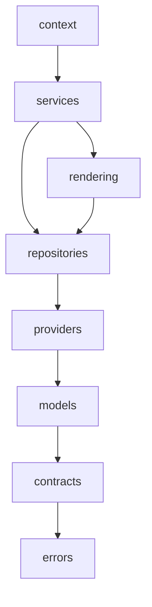
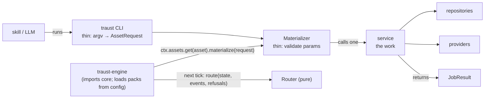
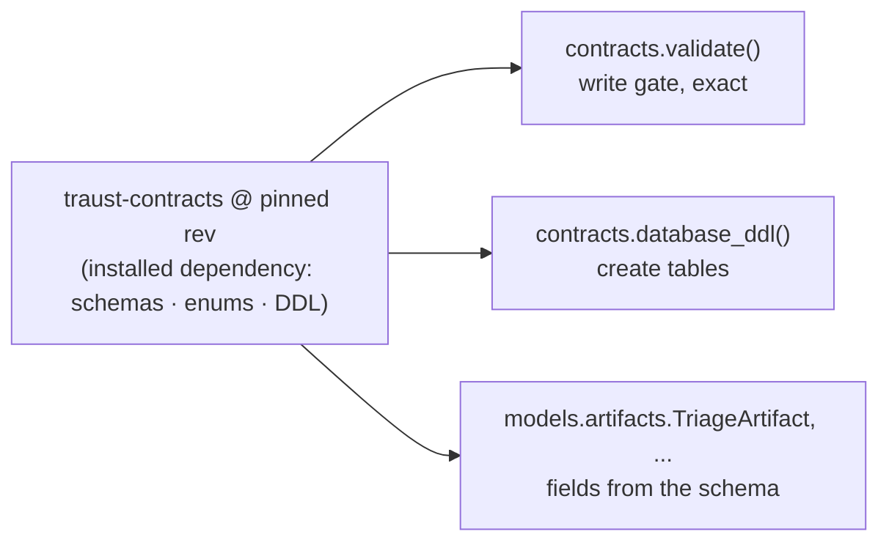

# traust-core

The shared Python base for traust: one clear place to read and write each kind of data, so scripts stop opening their own database connections, building their own paths, writing their own JSON and running their own subprocesses. Python callers (traust, traust-engine) use it in-process; other languages (the Go SDK, SCI) will reach the same services through the REST API served from here (resource/ID routes, request IDs, OpenAPI generated from the core models).

All modules live under `traust_core.v1` (see [Versioning](#versioning)).

| API | Module | Use it for | Instead of |
|---|---|---|---|
| **Contracts** | `contracts` | the pinned traust-contracts dependency, read as data: `validate(name, doc)` (exact JSON Schema gate), `validate_config(name, doc)` (the `config/v1` gate: packs, policies), `schema()`, `enum_values()`, `normalize_enum(name, value)` (registry read view), `database_ddl(dialect)` (every namespace, bootstrap order) | skills remembering to run `reporting validate` |
| **Errors** | `errors` | the exception hierarchy every layer raises (`ValidationError`, `NotFoundError`, …) | ad hoc exceptions |
| **Models** | `models` | one model per contract table, grouped by section — `inventory`, `dependencies`, `assessment`, `findings`, `operations`, `ledger` (fields = columns) — next to that section's service types; `base` (`Model` strict, `Dto` tolerant, `Entity` with a database-generated UUIDv4 id, `AppendOnly` for tables that are never updated), `values` (`HttpsRepoUrl`, `GitSha`, `CveId`), `integrity` | dicts passed between scripts |
| **Validation rules** | `models.validation` | `ValidationScope.permits(action, target, as_of=…)`, `ValidationPlan.requires_approval()`, `ValidationAttempt.soundness()` — pure scope, approval and refutation rules | duplicated harness scope and soundness rules |
| **Artifacts** | `models.artifacts` | the `ArtifactDocument` base + `SchemaView` (fields from the installed schema, `doc.findings[0].verdict`, unknown names raise) and the named documents (`TriageArtifact`, `SecurityAuditArtifact`, …, `Verdict`, `Severity`) | `json.load` + `.get("key")` |
| **Artifact publishing** | `services.artifact_publishing` | `ctx.artifact_publisher(specs).publish(name, raw)` or `.publish_artifact(artifact)`: exact gate → content-addressed objects → an artifact UUID on SQLite and Postgres; `get(artifact_id)` verifies the persisted digest; `list_for_assessment(id, kind=…)` reads metadata | writing `analysis-results` files by hand or optional indexing |
| **Code facts** | `services.code_facts`, `models.code_facts`, `providers.crypto`, `providers.crypto_image`, `providers.crypto_cluster`, `providers.route_guards`, `providers.config_matrix`, `providers.sanitizers`, `providers.fork_lag`, `providers.priv_profile`, `providers.tree`, `models.elf_formats`, `models.crypto_formats` | `ctx.services().code_facts.collect/list/symbols/language_stats` over the latest `tool_scan` assessment's `CodeFactsArtifact`; measured LoC, exact symbol filters and snapshot-bound pagination. `code_facts.enumerate(kind, ToolRequest)` runs a deterministic `FactEnumerator` over a checkout (`CryptoProbe`: toolchains, images, policies a checkout configures; the secure-code pre-scans `RouteGuardMatrix`, `ConfigMatrix`, `SanitizerDiscovery` and `ForkDetector`, over `providers.tree`'s symlink-safe file walk); `code_facts.route_guards(ToolRequest, resolve_handlers=)` places handlers through the symbol index; `code_facts.priv_profile(ToolRequest, repo)` is the operator privilege profile (`PrivProfiler`: SCC requests, securityContexts, namespaces and install modes, every RBAC rule, and the shipped RBAC no `+kubebuilder:rbac` marker declares) as the contract `PrivProfileArtifact`; `code_facts.fork_lag(ToolRequest, offline=)` adds each tracked upstream version's advisories (`exposure.package_advisories`), a failed read being the result's `network` error; `code_facts.crypto(ref_id, ToolRequest)` adds the crypto packages of the ref's ingested manifest SBOM (`services.crypto_packages.CryptoPackagePolicy` over `exposure.dependencies`; `NoManifestSbomError` when none was ingested). `code_facts.image_crypto(digest, ImageRequest)` is the image tier (podman/docker inspect, create and `cp` through `ProcessRunner`, never running the image; DT_NEEDED from `models.elf_formats`) plus the crypto packages of the image's SBOM (`exposure.image_dependencies`; `NoImageSbomError`); `code_facts.cluster_crypto(ClusterRequest, ValidationScope)` is the cluster tier (`oc exec`, `openssl s_client` parsed by `models.crypto_formats`), every exec namespace gated by `ValidationScope.decide(k8s, exec)` and logged. Nothing is recorded: the facts are re-derivable from the commit | source scans at read time, a side symbol database, byte-based LoC estimates, `traust_engine.adapters.crypto_probe`, `crypto_audit` image/cluster tiers, `_util/elf.py` (linked libraries), traust secure-code-audit `enumerate_route_guards.py`, `expand_config_matrix.py`, `probe_sanitizers.py` discovery, `run_fork_advisory_lag.py`, operator-priv-profile `build_priv_profile.py` |
| **Detection quality** | `services.detection_quality`, `models.detection_quality` | `ctx.services().detection_quality`: `record(BenchmarkTargetArtifact, provenance)` stores the recall-benchmark answer key (newest version scored; duplicate ids and held-out seeded targets refused); `run_benchmark({target_id: [assessment_id, rerun_id]})` scores each `benchmark_audit` report with the match ladder (fingerprint → advisory id + path → CWE + path ≥ 0.5 → near miss), injection canaries and rerun stability, `BenchmarkRun.scorecard()` cuts recall by CWE/severity/provenance/language/split; `screen_injection(artifact_id)` flags obeyed-injection shapes in an audit report; `mine_rules(RulePack)` clusters confirmed findings by (primary CWE, language) against a pack, with per-rule precision from `occurrence.rule` and the calibration worklist; `sweep_cards(CardDeck.parse(doc).cards, ToolRequest)` runs each semantic precedent card's code-facts enumerator over a checkout and returns the rows its predicate matches as triage candidates (cards that are prose, not recipes, are rejected by `CardDeck.parse` with every reason) | `recall-benchmark/{match_benchmark,screen_injection}.py`, `traust_engine.sweep.mining`, traust `ops/compile_precedent_cards.py` |
| **Tool runs and audits** | `services.assessment`, `models.cloud_config`, `services.cloud_config` | `assessment.run_tools(checkout, [CHECKOV])` over `ctx.tools` (every tool ready first); `CloudConfigFacts.of(CheckovScan)` turns Checkov output into cited facts, fact ids, gaps and a snapshot id; `assessment.check_audit(doc)` then `record_audit(doc, ref, provenance)`: the report gate, a `cloud-config` assessment (degraded with gaps), every finding it states and its judgment on each as a decision (`FindingDecisions.record_assessed`) | `run_checkov.py`'s normalizer, gap register and `--validate-report` |
| **Analysis results** | `repositories.objects.analysis_results` | `ctx.analysis_results().read(TriageArtifact, subject)` / `.read_all(TriageArtifact, tree)`; raw `put/get/find(subject, kind)`; today's naming convention in one place | `json.load` + `"-security-audit.json"` path building |
| **Table repositories** | `repositories.traust.*`, `repositories.traust_ops`, `repositories.traust_ledger`, `repositories.contract` | one repository per contract table (`uow.findings.find_by_fingerprint(...)`, `uow.run_orders.claim(...)`); `SqlTraustUnitOfWork(engine)` opens all 32 on one connection — one transaction across sections | `sqlite3.connect`, inline SQL, per-script tables |
| **Repository observation** | `providers.forge`, `services.observation`, `services.portfolio`, `context.designations` | gh/glab measurements through `ProcessRunner` (`CommandSourceProvider`, strict reply validation); targets and open counts read the contract tables (`repository`, `assessment`, the `finding_status` view); `RepoStateQuery.observed` derives exposure / risk tier / freshness. forge facts live for one observation session (open model question: stored `repo_state` or live at routing time) | per-script forge scraping, findings.db direct reads |
| **Records (pattern)** | `repositories.sql`, `repositories.tables` | `TableSpec` (columns once) + `TableFactory` (Postgres schemas or SQLite `ops_`/`ledger_` prefixes, by engine) + `SqlTableRepository` (`add`/`get`/`update`) on SQLAlchemy Core; sqlite or Postgres by URL. `record_columns()` (mutable: UUIDv4 id + `created_at` + `updated_at`) / `append_only_columns()` (UUIDv4 id + `created_at`, no `updated_at`) + `_insert_record`/`_update_record`, database-generated via `RETURNING`; `updated_at` kept by the contracts touch trigger, SQLite `uuid()` registered by `create_database_engine` | `sqlite3.connect`, inline SQL, client-minted ids/timestamps |
| **Object store** | `repositories.objects.store` | `ObjectStore.put/get/list` raw bytes by key, digest-verified (local dir; S3 later) | `write_text`, `json.dump` |
| **REST API** | `rest` (`traust-core[rest]`) | `traust-server` / `create_app(context)`: routes only, one package per domain (`rest.ledger`, …, listed in `rest.domains`), shared plumbing in `rest.common`; bearer token → `Principal` (`Caller`), one unit of work per request (`CoreServices`), typed errors → problem+json, `X-Request-ID` / `traceparent` on every response and access-log line; OpenAPI from `make api-check`. Nothing else in core imports it | a REST service per repo, each with its own auth, errors and config |
| **Reporting** | `services.reporting` | `ctx.services().reporting` over a report document the caller holds, nothing stored: `validate(payload, XArtifact)` → contract `Issue`s; `lint(doc, files=None)` runs every core `Lint` registered for the type; `render(doc, RenderFormat.MARKDOWN \| HTML)` (triage today); `sarif(doc)` for report and cloud-config audits (`SarifExport.report`, `locations.sarif_tool_uri` as `informationUri`). `ctx.services().redaction.redact(payload)` scrubs secrets (`RedactionPolicy`) | `traust_engine.reporting` (`validate`, `lint`, `render`, `sarif`), `_util/redact.py` |
| **Rendering** | `rendering` | `Report` → `MarkdownRenderer` → `publish()`; `markdown_table()` | 18 copies of `render_md` |
| **Jobs** | `models.operations`, `services.operations` | `Materializer.materialize(AssetRequest) -> JobResult` (succeeded · degraded · refused · failed): the seam traust-engine calls; `Router` for continuous-ops `route()` | each CLI inventing its own exit codes |
| **Providers** | `providers` | the outside world: `base` (`Provider`, `Readiness`, `Provenance`, registry), `tools`, `sources`, `feeds` (`FeedProvider`, `HttpFileFeed` for single-file feeds, `validate_payload`), `http` (`HttpFetcher` + `RetryPolicy`, the outbound HTTP path), `process` (`ProcessRunner`, the only subprocess path), `clock` | ad hoc `subprocess`/`git`/fetch code, 22 private `run` wrappers |
| **Config + Context** | `context` | one `traust.yaml`; `Context` builds everything ([ledger and identity sections](docs/configuration.md)) | `os.environ`, scattered config files |

## Validation rules

`ValidationAction(kind, verb)` describes a scope operation; `ValidationTarget` supplies its
context, namespace, resource, name, image, artifact ID or URL. `ValidationActionKind` covers
Kubernetes, container, WASM, browser, credential and inventory operations; it is distinct
from the contracts-owned execution-adapter vocabulary on `ValidationPlan.adapter`.

`ValidationScope.permits(action, target, as_of=date)` evaluates expiry, off-limits rules,
control-plane locks and positive grants. The caller supplies the date from `Clock` and
resolves WASM artifacts to UUIDs before evaluating scope. Binding `modes` retain their
constituent modes; credential and inventory grants require `explicit`. Cluster
`explicit_namespaces` contain only explicit engagement grants, never inline or inferred ones.
Browser verbs come from the first target whose origin matches the concrete URL.

`ValidationPlan.requires_approval()` is true for `interactive`, false for `auto` and
`dry-run`. It answers the human-review requirement, not permission to execute.

`ValidationAttempt.soundness()` returns `SoundnessResult(verdict, flag)` without changing
the attempt. `ValidationProbe` projects only the needed observations: verdict, verb,
transcript, positive-control outcomes and differential discrimination. The caller supplies
deployment-failure observations and the required `controls_required` / `differential_required`
inputs (legacy report thresholds: 0.177.0 / 0.178.0). Producer-stamped flags are preserved;
unsound refutations become `inconclusive`. At finding level, one sound refuting probe can
sustain a refutation unless a deployment, control or differential gate invalidates it.

## Layers

Dependencies point inward only; `tests/v1/test_layering.py` fails the build on a violation.



## How work reaches a service



traust and traust-engine import core and call services in-process. The CLI exists only so an LLM can enter the Python world. Worked example: `tests/v1/example/continuous_ops/`.

## Two setups, one API

| | Local user | SCI / team |
|---|---|---|
| Config | `artifacts.path` only | + `database.url` (Postgres), object store |
| `ArtifactPublisher.publish` | validate → objects → SQLite `artifact` row | validate → objects → Postgres `artifact` row |

With no `database.url`, `Context` keeps the record store in SQLite at `<home>/traust.db` (`home` defaults to `~/.traust`) and creates the schema from the traust-contracts DDL on first use. A configured `database.url` is never touched: whoever provisions it creates the schema (`apply_schema(engine, contracts.database_ddl(dialect))`). `ctx.services()` builds every service over one shared unit of work. Contracts owns and tests the schema; core tests repository behaviour.

## Usage

```yaml
# traust.yaml (local user)
artifacts: { path: ./analysis-results }
```

```python
ctx = Context.from_file(Path("traust.yaml"))  # entry point only
publisher = ctx.artifact_publisher(SPECS)  # SPECS: the caller's PublishSpecs
published = publisher.publish("triage", raw_bytes)
triage = publisher.get(published.artifact_id)
```

## Worked examples (copy these shapes)

Code facts reads recorded documents; it never invokes tools. Attach a
`CodeFactsArtifact` through `AssessmentService.record(..., kind=AssessmentKind.TOOL_SCAN, ...)`.
The latest assessment is authoritative: failed/degraded scans, missing evidence,
and unmeasured sections are explicit errors, not zero counts or older snapshots.
Symbols are ordered by path, line and name and match exact name/path filters.
Facts pages are limited to 1–1000 entries, with cursors bound to the artifact and
requested kinds; a changed latest scan invalidates the cursor. Crypto facts are not
recorded: `code_facts.crypto(ref_id, ToolRequest(workspace=checkout))` runs the probe over the
checkout and reads crypto packages from the ref's dependency rows, so ingest the commit's
manifest SBOM first (`syft scan dir:<checkout> -o cyclonedx-json`, then
`exposure.ingest_sbom(raw, ref_id)`). The image tier reads the same way from the image's SBOM
(`syft scan <name>@<digest> -o cyclonedx-json`, then `exposure.ingest_image_sbom(raw, digest)`).
Other enumerator-specific fact kinds remain with their
skill-port slices.

`AnalysisResultsRepository` is the legacy path-keyed reader; new publisher output
is read by artifact ID. Companion documents are rendered from the validated
primary and stored by digest, but only the primary is an artifact-row document.
Publishing failure raises a typed error; an object left by a failed row write is
safe to retry because its key is content-addressed.

All in [`tests/v1/example/`](tests/v1/example):

| File | Shows |
|---|---|
| `model.py`, `repository.py`, `services.py` | SQL + in-memory repository mechanics over a non-contract table, unit of work, service (predates one-service-per-domain; for contract tables copy `repositories/traust/inventory/repository.py`) |
| `artifact_publishing.py` | a publish spec (`TRIAGE` over `TriageArtifact`) with a rendered markdown companion |
| `report.py` | read through a repository → pure `build_report` → render → publish |
| `router.py` | a pure router, table-tested |
| `provider.py` | a tool provider: request DTO, `check()`, `acquire()` with provenance |
| `continuous_ops/` | engine → materializer → service → repository → `JobResult`, then a pure router reads the stored state; the same service reached from a CLI |

The real table repository to copy is `src/traust_core/v1/repositories/traust/inventory/repository.py` (a `TableSpec`, a narrow protocol, a `SqlTableRepository` subclass); its tests are in `tests/v1/repositories/tables/`.

## Contracts

traust-contracts is a pinned dependency (`[tool.uv.sources]` git rev in `pyproject.toml`). traust-core reads its **data files** (schemas, enums, DDL) from the installed package, through `traust_core.v1.contracts` only. Nothing is copied or generated.



| Task | How |
|---|---|
| Move to a new contracts version | change the `rev` in `pyproject.toml`, `uv sync`, `make test` |
| Try an unreleased contracts change | `uv add --editable ../traust-contracts` locally (don't commit) |
| Add a named artifact | one line in `models/artifacts.py`: `class XArtifact(ArtifactDocument, name=…, schema=…, kind=…)` |
| See an artifact's fields | `TriageArtifact.describe()` (field tree with types, required/optional); `TriageArtifact.schema_path()` |

### Registry reader review candidate

`contracts.normalize_enum(name, value)` reads replacement metadata from the
installed pinned contracts data through this module's existing resource loader.
The Python placement and affected-contract review remain pending; this callable
candidate does not activate ledger reads or writers.

```python
from traust_core.v1 import contracts

view = contracts.normalize_enum("source_type", "interactive")
for pair in view.pairs:
    print(pair.enum, pair.value)
```

Unlike the existing filename-stem APIs `enum_values("source-type")` and
`enum("source-type")`, the normalizer accepts the registry document's exact
`name`, such as `source_type`, matching the Go SDK. There is no separator,
case or Unicode folding. Unknown enum names raise `ConfigError`; unknown values
in a known enum retain their exact spelling, because readers are not validators.

The frozen `EnumNormalization` contains ordered `EnumValue` pairs and a
`dropped` flag. Declared rename/merge/split replacements retain their order.
Retired keys still resolve when absent from current values; a one-way drop keeps
the original pair with `dropped=True`. Results cannot poison the cached registry.
The currently pinned data declares no deprecations, so values read unchanged;
legacy effort strings are never inferred to be sizes. Free-text mapping and
cross-field policy remain outside this API.

Neutral acceptance cases are authored in contracts' test fixtures and retained
as test-only copies in Core and SDK, not packaged runtime definitions. They
exercise replacements without choosing production vocabulary or requiring a
sibling checkout. No dependency pin or historical payload changes are made.

## Two kinds of code

| Kind | Answers | Lives in |
|---|---|---|
| **Core** | *what* the data means and *how* it is stored, read and run: models, repositories, services, policies | this repo, by role: `models/<section>.py`, `repositories/traust/<section>/<table>.py` (+ `traust_ops/`, `traust_ledger/`), `services/<subject>.py` (`services/findings/` is a package) |
| **Pack policy** | *when / which*: routing rules, cadences, lanes, skills, CLIs | traust (`traust_pack_security`), not this repo |

Everything here is `v1` API, reshaped in place until it is frozen. Each contract table has one repository; beyond `add`/`get`/`update` its methods are the questions asked of that table. Tests mirror `src`: `tests/v1/<role>/test_<subject>.py`.

## Rules

- Services never open connections, build paths, start processes or read env vars; they receive what they need through their constructor.
- `Context` at entry points only.
- Data is parsed into a model once, at the edge. No bare `dict` across a function boundary.
- SQLAlchemy Core only: no ORM mapped classes. Models never know about the database; the shared repository base gives only `add`/`get`/`update`.
- Unknown or unmeasured values are `None`, never `0`.
- Every table repository has behaviour tests on SQLite and Postgres; stores and providers have contract tests.
- traust-core is the hub: other traust repos depend on it, not the reverse. The only code dependency is traust-ledger's pure functions (Merkle, signing, verifying), imported only by `services/ledger.py`; traust-contracts is pinned data. HTTP only in providers (outbound) and the HTTP adapter (inbound).

## Domain services (stubs)

Repositories are real; services are mostly stubs. Every stub raises `NotImplementedError("stub: replaces …")` naming the code it replaces. A service declares the section unit of work it needs; `SqlTraustUnitOfWork` satisfies every one on one connection.

| Domain | Service | Unit of work (tables) |
|---|---|---|
| Portfolio: what we protect | `services.portfolio` · `PortfolioService`, `PortfolioSync` (forge org listings and single repositories into the inventory; `import_owners` mirrors the one declared ownership source; `owner_hints` are OWNERS / contributor handles, never stored), `RepoStateQuery` | `InventoryUnitOfWork` (product, release, component, repository, repository_ref, team, ownership) |
| Onboarding: bring a project under the platform | `services.onboarding` · `OnboardingService` (`plan` dry run with gaps, `onboard` registers product, repositories, branches, teams and plans the baseline orders) | none: composes `PortfolioService`, `PortfolioSync`, `OpsService` |
| Exposure: known vulns reaching us | `services.exposure` · `ExposureService` (`refresh_feed` snapshots a feed, `refresh_feeds` every registered one (a failed feed keeps its last snapshot and reports `last_error`); an incremental feed (`providers.feeds.PagedJsonFeed`, Red Hat CVEs) builds on its last snapshot; staleness is the latest `feed_snapshot`; `exploit_signals` reads EPSS and KEV per advisory from the latest snapshots; `exploit_context` joins them onto the CVE-bearing items of an artifact's `findings` / `candidates` list, with the repository's product reach and owning teams (through `PortfolioService`); `source_document` returns a registered feed source's document for one identifier (`providers.feeds.FeedSource`: NVD, Red Hat CSAF and VEX documents, Scorecard), whose declared probes are `ProviderCatalog` readiness (`feed-source:*`); `find_advisory` fetches an advisory through `providers.osv` and keeps its identity, aliases and packages, ranges stay on the `AdvisoryRecord`; `ingest_sbom` reads CycloneDX / SPDX JSON (`models.sbom_formats`) into a commit's manifest SBOM; `dependencies(ref_id)` reads it back as package + version rows (`NoManifestSbomError` when none was ingested); `ingest_image_sbom` / `image_dependencies(digest)` do the same for an image's SBOM on its append-only `image` row (`NoImageSbomError`); `affected` is the blast radius through base images and internal libraries; `prepare` / `record` are the impact-analysis skill doors: one commit's evidence and classification (`ImpactEvidence.classification`), with the `providers.impact` tiers (govulncheck, source scans) over a checkout the caller passes; `resolve_symbols` returns the functions the advisory's fix touched (OSV-published, else mined from fix commits through `SourceProvider.commit`); `consumes_fix` says whether a commit's SBOMs carry a fix released elsewhere), then an `impact` assessment and, for an affected commit, its dependency finding) | `TraustUnitOfWork` (package, sbom, dependency, image, advisory, advisory_package, feed_snapshot + findings) |
| Assessment: what we looked at | `services.assessment` · `AssessmentService` | `AssessmentsUnitOfWork` (assessment, artifact, occurrence, location) |
| Findings: what's wrong and every decision on it | `services.findings` · `FindingService` + `intake`, `decisions`, `review`, `precedents`; `IdentityPolicy`, `RatingPolicy` | `TraustUnitOfWork` (finding, cwe, finding_cwe, finding_label, finding_external_ref, decision, review_item); dispositions are SQL views over `decision` |
| Attestation: human sign-off | `services.attestation` · `AttestationService` | `FindingsUnitOfWork` — a human answer is a `decision` that resolves a `review_item` |
| Identity: who is acting | `services.identity` · `IdentityService`; `models.identity` (`Principal`, `Role`) | none: principals come from `providers.identity` (OIDC, local user, directory) |
| Operations: orders, leases, spend | `services.operations` · `OpsService`, `SpendService` | `OpsUnitOfWork` (run_batch, run_order, spend_event, feed_snapshot, assessment_input) |
| Ledger: proof of decisions | `services.ledger` · `LedgerService`: an append grows the layer's tree from its stored frontier (O(log n), never rereads events); `decide` / `restate` sign their append, `record` seals once per triage; `verify` / `checkpoint` recompute from events; `audit` verifies every layer, for the scheduled `ledger_audit` asset | `LedgerUnitOfWork` (layers, events) |
| PQC, code facts, compliance, detection quality | `services.pqc`, `services.code_facts`, `services.compliance`, `services.detection_quality` | `AssessmentsUnitOfWork` — content is read from the assessment's artifacts, never tables |
| Validation, remediation | `services.validation`, `services.remediation` | `TraustUnitOfWork` — assessments + decisions + external refs + artifacts |

Insight (dashboards) has no repository: views read services and render.

### Operational classifiers

`models.operations.OrderState`, `OrderReason`, `WorkLane` and `RescanEventSource`
load their values from the pinned contracts registry. `OpsService.submit`, `plan`
and `schedule` validate new routing classifiers; completion and withholding validate
reason codes before changing an order or publishing its run manifest.
An asset such as `dashboards` is not a lane: unrouted work leaves `lane=None`.
Existing lane, event-source and reason text remains readable without relabelling
historical rows. Current machine codes keep their existing spelling; diagnostic
prose is emitted in structured logs rather than stored as a new reason code.

`DegradedKey` owns common gap causes and ledger counters. `Context.services()`
also permits identifiers from its current feed registry and the insight view model;
registering a feed after service construction is respected without fetching it.
Completion rejects unknown keys and invalid counts before changing a lease or
publishing a manifest. Source/view counts are not collapsed into generic causes.
Historical unknown keys remain readable and survive progress updates; original
artifact bytes remain unchanged.


### Scanner precedent inputs

`AssessmentService.record_scan` preserves an unambiguous SARIF enclosing function or method
in `CodeSpan.symbol` and the stored `location.symbol`. Inline logical locations, run-level
indices and parent references are supported; fully qualified names take precedence. Missing
or ambiguous functions remain unknown. `FindingDecisions.prepare` attaches prior adjudications
matching that symbol, the vendor-normalized file path and a shared CWE.

Intake reconciles duplicate location claims across the batch before inserting them. A single
supplied symbol is retained; conflicting symbols roll back the intake. Retries preserve the
original append-only locations, and later assessments can supply additional metadata.

## Not built yet

| Item | Where |
|---|---|
| Layout contract (path template + kinds) replacing today's hard-coded convention | traust-contracts, `repositories.objects.analysis_results` |
| First real providers (git, forges; paginated and indexed feeds such as rh-cve and VEX) | packages / `providers.feeds` |
| S3 object store backend | `repositories.objects.store` |

## Versioning

`traust_core.v1` is the platform API, reshaped in place until it is frozen. There are no releases: consumers pin a git commit SHA (`[tool.uv.sources] traust-core = { git = "…", rev = "<sha>" }`), the same way core pins traust-contracts.

## Development

```bash
make setup              # uv sync + git hooks (lint on commit, conventional subject, lint + coverage on push)
make lint-fix
make test               # unit tests
make coverage           # + coverage (coverage-html for htmlcov/)

make db-up              # shared traust-postgres container (same as contracts and ledger)
make test-integration   # Postgres tests (marked `integration`)
make test-repositories  # repository layer on SQLite and Postgres
make db-down
```
