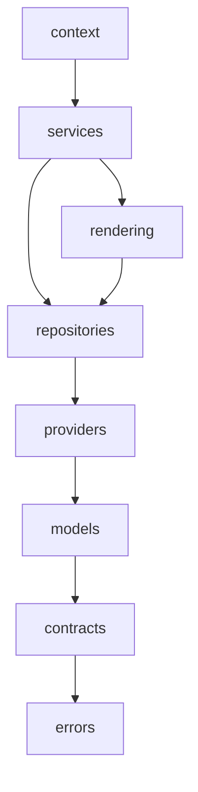
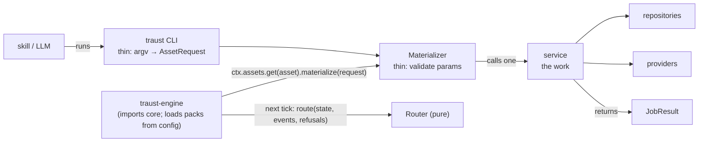
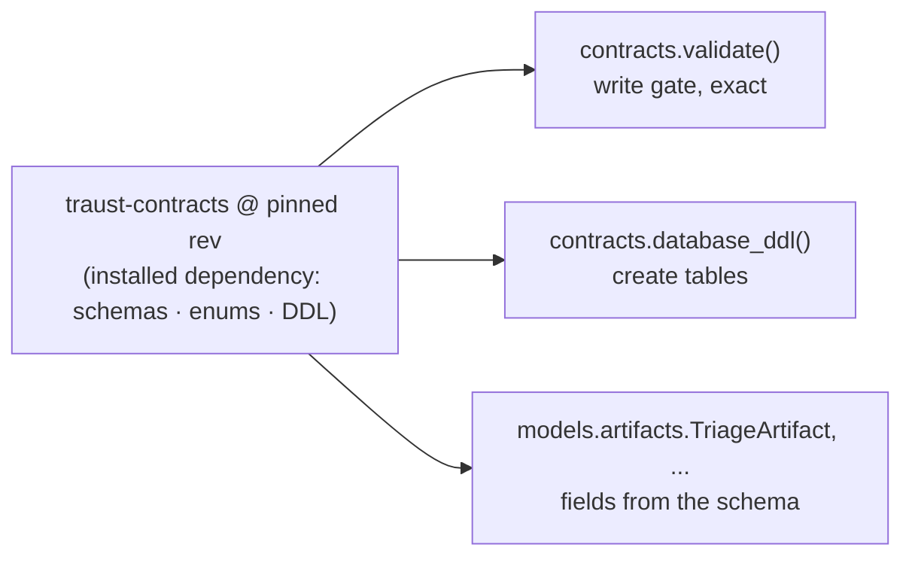

# traust-core

The shared Python base for traust: one clear place to read and write each kind of data, so scripts stop opening their own database connections, building their own paths, writing their own JSON and running their own subprocesses. Python callers (traust, traust-engine) use it in-process; other languages (the Go SDK, SCI) will reach the same services through the REST API served from here (resource/ID routes, request IDs, OpenAPI generated from the core models).

All modules live under `traust_core.v1` (see [Versioning](#versioning)).

| API | Module | Use it for | Instead of |
|---|---|---|---|
| **Contracts** | `contracts` | the pinned traust-contracts dependency, read as data: `validate(name, doc)` (exact JSON Schema gate), `schema()`, `enum_values()`, `normalize_enum(name, value)` (registry read view), `database_ddl(dialect)` (every namespace, bootstrap order) | skills remembering to run `reporting validate` |
| **Errors** | `errors` | the exception hierarchy every layer raises (`ValidationError`, `NotFoundError`, …) | ad hoc exceptions |
| **Models** | `models` | one model per contract table, grouped by section — `inventory`, `dependencies`, `assessment`, `findings`, `operations`, `ledger` (fields = columns) — next to that section's service types; `base` (`Model` strict, `Dto` tolerant, `Entity` with a database-generated UUIDv4 id, `AppendOnly` for tables that are never updated), `values` (`HttpsRepoUrl`, `GitSha`, `CveId`), `integrity` | dicts passed between scripts |
| **Validation rules** | `models.validation` | `ValidationScope.permits(action, target, as_of=…)`, `ValidationPlan.requires_approval()`, `ValidationAttempt.soundness()` — pure scope, approval and refutation rules | duplicated harness scope and soundness rules |
| **Artifacts** | `models.artifacts` | the `ArtifactDocument` base + `SchemaView` (fields from the installed schema, `doc.findings[0].verdict`, unknown names raise) and the named documents (`TriageArtifact`, `SecurityAuditArtifact`, …, `Verdict`, `Severity`) | `json.load` + `.get("key")` |
| **Artifact publishing** | `services.artifact_publishing` | `ctx.artifact_publisher(specs).publish(name, subject, raw, run_id)` (LLM) or `.publish_artifact(artifact, subject, run_id)` (code): exact gate → files (always) → an `artifact` row (when `database.url` is set) | writing `analysis-results` files by hand |
| **Analysis results** | `repositories.objects.analysis_results` | `ctx.analysis_results().read(TriageArtifact, subject)` / `.read_all(TriageArtifact, tree)`; raw `put/get/find(subject, kind)`; today's naming convention in one place | `json.load` + `"-security-audit.json"` path building |
| **Table repositories** | `repositories.traust.*`, `repositories.traust_ops`, `repositories.traust_ledger`, `repositories.contract` | one repository per contract table (`uow.findings.find_by_fingerprint(...)`, `uow.run_orders.claim(...)`); `SqlTraustUnitOfWork(engine)` opens all 32 on one connection — one transaction across sections | `sqlite3.connect`, inline SQL, per-script tables |
| **Repository observation** | `providers.forge`, `services.observation`, `services.portfolio`, `context.designations` | gh/glab measurements through `ProcessRunner` (`CommandSourceProvider`, strict reply validation); targets and open counts read the contract tables (`repository`, `assessment`, the `finding_status` view); `RepoStateQuery.observed` derives exposure / risk tier / freshness. forge facts live for one observation session (open model question: stored `repo_state` or live at routing time) | per-script forge scraping, findings.db direct reads |
| **Records (pattern)** | `repositories.sql`, `repositories.tables` | `TableSpec` (columns once) + `TableFactory` (Postgres schemas or SQLite `ops_`/`ledger_` prefixes, by engine) + `SqlTableRepository` (`add`/`get`/`update`) on SQLAlchemy Core; sqlite or Postgres by URL. `record_columns()` (mutable: UUIDv4 id + `created_at` + `updated_at`) / `append_only_columns()` (UUIDv4 id + `created_at`, no `updated_at`) + `_insert_record`/`_update_record`, database-generated via `RETURNING`; `updated_at` kept by the contracts touch trigger, SQLite `uuid()` registered by `create_database_engine` | `sqlite3.connect`, inline SQL, client-minted ids/timestamps |
| **Object store** | `repositories.objects.store` | `ObjectStore.put/get/list` raw bytes by key, digest-verified (local dir; S3 later) | `write_text`, `json.dump` |
| **REST API** | `rest` (`traust-core[rest]`) | `traust-server` / `create_app(context)`: routes only, one package per domain (`rest.ledger`, …, listed in `rest.domains`), shared plumbing in `rest.common`; bearer token → `Principal` (`Caller`), one unit of work per request (`CoreServices`), typed errors → problem+json, `X-Request-ID` / `traceparent` on every response and access-log line; OpenAPI from `make api-check`. Nothing else in core imports it | a REST service per repo, each with its own auth, errors and config |
| **Rendering** | `rendering` | `Report` → `MarkdownRenderer` → `publish()`; `markdown_table()` | 18 copies of `render_md` |
| **Jobs** | `models.operations`, `services.operations` | `Materializer.materialize(AssetRequest) -> JobResult` (succeeded · degraded · refused · failed): the seam traust-engine calls; `Router` for continuous-ops `route()` | each CLI inventing its own exit codes |
| **Providers** | `providers` | the outside world: `base` (`Provider`, `Readiness`, `Provenance`, registry), `tools`, `sources`, `feeds` (`FeedProvider`, `HttpFileFeed` for single-file feeds, `validate_payload`), `http` (`HttpFetcher` + `RetryPolicy`, the outbound HTTP path), `process` (`ProcessRunner`, the only subprocess path), `clock` | ad hoc `subprocess`/`git`/fetch code, 22 private `run` wrappers |
| **Config + Context** | `context` | one `traust.yaml`; `Context` builds everything ([ledger and identity sections](docs/configuration.md)) | `os.environ`, scattered config files |

## Validation rules

`ValidationAction(kind, verb)` describes a scope operation; `ValidationTarget` supplies its
context, namespace, resource, name, image, artifact ID or URL. `ValidationActionKind` covers
Kubernetes, container, WASM, browser, credential and inventory operations; it is distinct
from the contracts-owned execution-adapter vocabulary on `ValidationPlan.adapter`.

`ValidationScope.permits(action, target, as_of=date)` evaluates expiry, off-limits rules,
control-plane locks and positive grants. The caller supplies the date from `Clock` and
resolves WASM artifacts to UUIDs before evaluating scope. Binding `modes` retain their
constituent modes; credential and inventory grants require `explicit`. Cluster
`explicit_namespaces` contain only explicit engagement grants, never inline or inferred ones.
Browser verbs come from the first target whose origin matches the concrete URL.

`ValidationPlan.requires_approval()` is true for `interactive`, false for `auto` and
`dry-run`. It answers the human-review requirement, not permission to execute.

`ValidationAttempt.soundness()` returns `SoundnessResult(verdict, flag)` without changing
the attempt. `ValidationProbe` projects only the needed observations: verdict, verb,
transcript, positive-control outcomes and differential discrimination. The caller supplies
deployment-failure observations and the required `controls_required` / `differential_required`
inputs (legacy report thresholds: 0.177.0 / 0.178.0). Producer-stamped flags are preserved;
unsound refutations become `inconclusive`. At finding level, one sound refuting probe can
sustain a refutation unless a deployment, control or differential gate invalidates it.

## Layers

Dependencies point inward only; `tests/v1/test_layering.py` fails the build on a violation.



## How work reaches a service



traust and traust-engine import core and call services in-process. The CLI exists only so an LLM can enter the Python world. Worked example: `tests/v1/example/continuous_ops/`.

## Two setups, one API

| | Local user | SCI / team |
|---|---|---|
| Config | `artifacts.path` only | + `database.url` (Postgres), object store |
| `ArtifactPublisher.publish` | validate → files | validate → files → `artifact` row |

With no `database.url`, `Context` keeps the record store in SQLite at `<home>/traust.db` (`home` defaults to `~/.traust`) and creates the schema from the traust-contracts DDL on first use. A configured `database.url` is never touched: whoever provisions it creates the schema (`apply_schema(engine, contracts.database_ddl(dialect))`). `ctx.services()` builds every service over one shared unit of work. Contracts owns and tests the schema; core tests repository behaviour.

## Usage

```yaml
# traust.yaml (local user)
artifacts: { path: ./analysis-results }
```

```python
ctx = Context.from_file(Path("traust.yaml"))  # entry point only
publisher = ctx.artifact_publisher(SPECS)  # SPECS: the caller's PublishSpecs
publisher.publish("triage", subject, raw_bytes, run_id)  # LLM output
triage = ctx.analysis_results().read(TriageArtifact, subject)  # typed read
```

## Worked examples (copy these shapes)

All in [`tests/v1/example/`](tests/v1/example):

| File | Shows |
|---|---|
| `model.py`, `repository.py`, `services.py` | SQL + in-memory repository mechanics over a non-contract table, unit of work, service (predates one-service-per-domain; for contract tables copy `repositories/traust/inventory/repository.py`) |
| `artifact_publishing.py` | a publish spec (`TRIAGE` over `TriageArtifact`) with a rendered markdown companion |
| `report.py` | read through a repository → pure `build_report` → render → publish |
| `router.py` | a pure router, table-tested |
| `provider.py` | a tool provider: request DTO, `check()`, `acquire()` with provenance |
| `continuous_ops/` | engine → materializer → service → repository → `JobResult`, then a pure router reads the stored state; the same service reached from a CLI |

The real table repository to copy is `src/traust_core/v1/repositories/traust/inventory/repository.py` (a `TableSpec`, a narrow protocol, a `SqlTableRepository` subclass); its tests are in `tests/v1/repositories/tables/`.

## Contracts

traust-contracts is a pinned dependency (`[tool.uv.sources]` git rev in `pyproject.toml`). traust-core reads its **data files** (schemas, enums, DDL) from the installed package, through `traust_core.v1.contracts` only. Nothing is copied or generated.



| Task | How |
|---|---|
| Move to a new contracts version | change the `rev` in `pyproject.toml`, `uv sync`, `make test` |
| Try an unreleased contracts change | `uv add --editable ../traust-contracts` locally (don't commit) |
| Add a named artifact | one line in `models/artifacts.py`: `class XArtifact(ArtifactDocument, name=…, schema=…, kind=…)` |
| See an artifact's fields | `TriageArtifact.describe()` (field tree with types, required/optional); `TriageArtifact.schema_path()` |

### Registry reader review candidate

`contracts.normalize_enum(name, value)` reads replacement metadata from the
installed pinned contracts data through this module's existing resource loader.
The Python placement and affected-contract review remain pending; this callable
candidate does not activate ledger reads or writers.

```python
from traust_core.v1 import contracts

view = contracts.normalize_enum("source_type", "interactive")
for pair in view.pairs:
    print(pair.enum, pair.value)
```

Unlike the existing filename-stem APIs `enum_values("source-type")` and
`enum("source-type")`, the normalizer accepts the registry document's exact
`name`, such as `source_type`, matching the Go SDK. There is no separator,
case or Unicode folding. Unknown enum names raise `ConfigError`; unknown values
in a known enum retain their exact spelling, because readers are not validators.

The frozen `EnumNormalization` contains ordered `EnumValue` pairs and a
`dropped` flag. Declared rename/merge/split replacements retain their order.
Retired keys still resolve when absent from current values; a one-way drop keeps
the original pair with `dropped=True`. Results cannot poison the cached registry.
The currently pinned data declares no deprecations, so values read unchanged;
legacy effort strings are never inferred to be sizes. Free-text mapping and
cross-field policy remain outside this API.

Neutral acceptance cases are authored in contracts' test fixtures and retained
as test-only copies in Core and SDK, not packaged runtime definitions. They
exercise replacements without choosing production vocabulary or requiring a
sibling checkout. No dependency pin or historical payload changes are made.

## Two kinds of code

| Kind | Answers | Lives in |
|---|---|---|
| **Core** | *what* the data means and *how* it is stored, read and run: models, repositories, services, policies | this repo, by role: `models/<section>.py`, `repositories/traust/<section>/<table>.py` (+ `traust_ops/`, `traust_ledger/`), `services/<subject>.py` (`services/findings/` is a package) |
| **Pack policy** | *when / which*: routing rules, cadences, lanes, skills, CLIs | traust (`traust_pack_security`), not this repo |

Everything here is `v1` API, reshaped in place until it is frozen. Each contract table has one repository; beyond `add`/`get`/`update` its methods are the questions asked of that table. Tests mirror `src`: `tests/v1/<role>/test_<subject>.py`.

## Rules

- Services never open connections, build paths, start processes or read env vars; they receive what they need through their constructor.
- `Context` at entry points only.
- Data is parsed into a model once, at the edge. No bare `dict` across a function boundary.
- SQLAlchemy Core only: no ORM mapped classes. Models never know about the database; the shared repository base gives only `add`/`get`/`update`.
- Unknown or unmeasured values are `None`, never `0`.
- Every table repository has behaviour tests on SQLite and Postgres; stores and providers have contract tests.
- traust-core is the hub: other traust repos depend on it, not the reverse. The only code dependency is traust-ledger's pure functions (Merkle, signing, verifying), imported only by `services/ledger.py`; traust-contracts is pinned data. HTTP only in providers (outbound) and the HTTP adapter (inbound).

## Domain services (stubs)

Repositories are real; services are mostly stubs. Every stub raises `NotImplementedError("stub: replaces …")` naming the code it replaces. A service declares the section unit of work it needs; `SqlTraustUnitOfWork` satisfies every one on one connection.

| Domain | Service | Unit of work (tables) |
|---|---|---|
| Portfolio: what we protect | `services.portfolio` · `PortfolioService`, `PortfolioSync`, `RepoStateQuery` | `InventoryUnitOfWork` (product, release, component, repository, repository_ref, team, ownership) |
| Exposure: known vulns reaching us | `services.exposure` · `ExposureService` (`refresh_feed` snapshots a feed; staleness is the latest `feed_snapshot`) | `TraustUnitOfWork` (package, sbom, dependency, image, advisory, advisory_package, feed_snapshot + findings) |
| Assessment: what we looked at | `services.assessment` · `AssessmentService` | `AssessmentsUnitOfWork` (assessment, artifact, occurrence, location) |
| Findings: what's wrong and every decision on it | `services.findings` · `FindingService` + `intake`, `decisions`, `review`, `precedents`; `IdentityPolicy`, `RatingPolicy` | `TraustUnitOfWork` (finding, cwe, finding_cwe, finding_label, finding_external_ref, decision, review_item); dispositions are SQL views over `decision` |
| Attestation: human sign-off | `services.attestation` · `AttestationService` | `FindingsUnitOfWork` — a human answer is a `decision` that resolves a `review_item` |
| Identity: who is acting | `services.identity` · `IdentityService`; `models.identity` (`Principal`, `Role`) | none: principals come from `providers.identity` (OIDC, local user, directory) |
| Operations: orders, leases, spend | `services.operations` · `OpsService`, `SpendService` | `OpsUnitOfWork` (run_batch, run_order, spend_event, feed_snapshot, assessment_input) |
| Ledger: proof of decisions | `services.ledger` · `LedgerService`: an append grows the layer's tree from its stored frontier (O(log n), never rereads events); `decide` / `restate` sign their append, `record` seals once per triage; `verify` / `checkpoint` recompute from events | `LedgerUnitOfWork` (layers, events) |
| PQC, code facts, compliance, detection quality | `services.pqc`, `services.code_facts`, `services.compliance`, `services.detection_quality` | `AssessmentsUnitOfWork` — content is read from the assessment's artifacts, never tables |
| Validation, remediation | `services.validation`, `services.remediation` | `TraustUnitOfWork` — assessments + decisions + external refs + artifacts |

Insight (dashboards) has no repository: views read services and render.

## Not built yet

| Item | Where |
|---|---|
| Layout contract (path template + kinds) replacing today's hard-coded convention | traust-contracts, `repositories.objects.analysis_results` |
| First real providers (git, forges; paginated and indexed feeds such as rh-cve and VEX) | packages / `providers.feeds` |
| S3 object store backend | `repositories.objects.store` |

## Versioning

`traust_core.v1` is the platform API, reshaped in place until it is frozen. There are no releases: consumers pin a git commit SHA (`[tool.uv.sources] traust-core = { git = "…", rev = "<sha>" }`), the same way core pins traust-contracts.

## Development

```bash
make setup              # uv sync + git hooks (lint on commit, conventional subject, lint + coverage on push)
make lint-fix
make test               # unit tests
make coverage           # + coverage (coverage-html for htmlcov/)

make db-up              # shared traust-postgres container (same as contracts and ledger)
make test-integration   # Postgres tests (marked `integration`)
make test-repositories  # repository layer on SQLite and Postgres
make db-down
```
